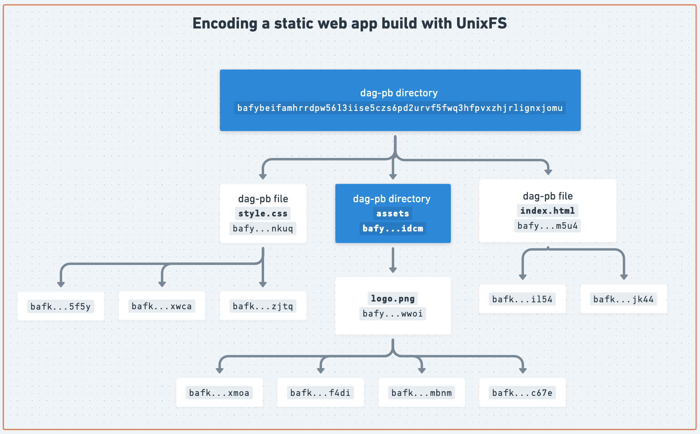

# Жизненият цикъл на данните в IPFS

- [1. Адресиране по съдържание / Merkleizing](#1-адресиране-по-съдържание--merkleizing)
- [2. Осигуряване / предоставяне](#2-осигуряване--предоставяне)
- [3. Извличане](#3-извличане)
- [Научете повече](#learn-more)

## 1. Адресиране по съдържание / Merkleizing

Първата фаза от жизнения цикъл на данните в IPFS е да се адресират по CID. Това е локална операция, която взима произволни данни и ги кодира, така че да могат да бъдат адресирани с CID. Това също се нарича _merkleizing_ на данните, защото входните данни се превръщат в [Merkle DAG](./merkle-dag.md).

Точният процес зависи от типа данни. За файлове и директории това се извършва чрез конструиране на [UnixFS](./file-systems.md#unix-file-system-unixfs) [Merkle DAG](./merkle-dag.md) ([спецификация](https://specs.ipfs.tech/unixfs/)). За други типове данни, като dag-cbor, това се извършва чрез кодиране на данните с [dag-cbor](https://ipld.io/docs/codecs/known/dag-cbor/), което се хешира, за да се получи CID.

Например, merkleizing на статично уеб приложение в UnixFS DAG изглежда така, където цялото приложение се адресира от CID в горния блок (`bafy...jomu`):

::: tip
Вижте [ръководството за адресиране по съдържание на набори от данни](../how-to/content-addressing-data-sets.md) за повече информация за различните подходи към адресирането на набори от данни с IPFS.
:::

## 2. Осигуряване / предоставяне

След като входните данни са merkleized и адресирани с CID, възелът обявява себе си като доставчик на CID-ът(ове) към мрежата IPFS, като по този начин създава публично съпоставяне между CID и възела. Това обикновено се нарича **providing**, други имена за тази стъпка са **publishing** и **advertising**. При routing системи с вграден expiration/TTL като Amino DHT, това се нарича и **reproviding**, за да се подчертае непрекъснатият характер на процеса, при който възелът рекламира provider records.

IPFS възлите обявяват CID(ове) към [DHT](./dht.md) или [IPNI](./ipni.md) — двете content routing системи, поддържани от [IPFS Mainnet](./glossary.md#mainnet).

### Какво е с Pinning?

[Pinning](./glossary.md#pinning) може да има леко различни значения в зависимост от контекста:

Накратко, pinning може да означава едно от следните:

- **Pin by CID:** Заявяване на услуга за pinning или IPFS възел да закрепи CID, без да качва данните; в този случай услугата за pinning или IPFS възелът извлича данните от provider възлите; процес, който може да се провали, ако няма налични providers. След закрепване услугата за pinning или възелът ще запази копие на данните локално и обикновено ще предоставя CID-овете, които закрепва, към мрежата. [Pinning API spec](https://ipfs.github.io/pinning-services-api-spec/) осигурява стандартен начин за това със services за pinning, въпреки че някои pinning services имат свои собствени API-та. С Kubo командата `ipfs pin add CID` може да се използва за закрепване на CID.
- **Pin data:** Качване на данни (файлове, директории и др.) към услугата за pinning и получаване на CID; в този случай услугата за pinning обработва merkleizing на данните, така че те да бъдат адресирани по CID. С Kubo командата `ipfs add file` се използва за merkleize и pin данните.

Накратко, pinning, когато е успешно, води до възел или pinning service **предоставящ** CID-овете към мрежата.

## 3. Извличане

В тази фаза IPFS възелът извлича блоковете на CID-а и конструира Merkle DAG. Това обикновено включва няколко стъпки:

- **Content routing:** IPFS възелът намира други IPFS възли, предоставящи CID-овете, които търсите. Content routing се осъществява или чрез [DHT](./dht.md), чрез задаване на вече свързани peers чрез [Bitswap](./bitswap.md), или чрез HTTP извикване към [delegated routing](https://github.com/ipfs/specs/blob/main/IPIP/0337-delegated-routing-http-api.md) сървър като [network indexer](https://cid.contact/). Терминът **content discovery** също често се използва за тази стъпка.

- **Block fetching:** IPFS възелът изтегля блоковете на Merkle DAG (на файла или директорията) от providers.

- **Verification:** IPFS възелът проверява изтеглените блокове, като ги хешира и гарантира, че полученият хеш е верен. Имайте предвид, че този тип извличане е _trustless_; тоест блоковете могат да идват от произволен възел в мрежата.

- **Local access:** След като всички блокове на DAG с искания CID са успешно репликирани локално, данните са налични за локален достъп.

## Научете повече

Научете повече за жизнения цикъл на данните в IPFS в следното видео:

@[youtube](iaVXRPsRCUc)
