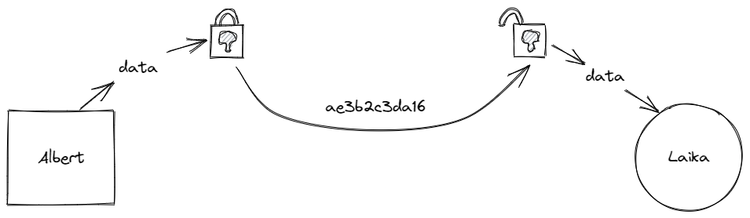
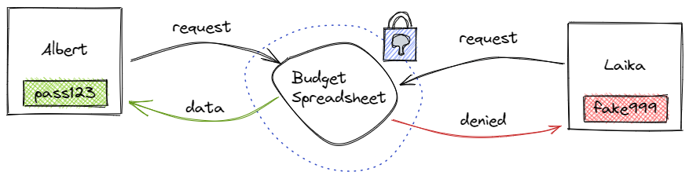

# Поверителност и криптиране

Като протокол за съхранение и доставка на данни между възли, IPFS е _публична мрежа_: възлите, участващи в мрежата, съхраняват данни, свързани с глобално последователни [адреси на съдържание](content-addressing.md) (CID) и обявяват, че имат тези CID налични за други възли, чрез публично видими [разпределени хеш таблици](dht.md) (DHT). Тази парадигма е една от основните силни страни на IPFS — в най-основния си вид това всъщност е глобално разпределен "сървър" на всички налични данни в мрежата, достъпни както по самото съдържание (тези CID), така и по участниците (възлите), които имат или искат съдържанието.

Това обаче означава, че самият IPFS не защитава изрично знанията _за_ CID и възлите, които ги предоставят или извличат. Това не е нещо уникално за децентрализираната мрежа; и в d-web, и в наследения уеб трафикът и другите метаданни могат да бъдат наблюдавани по начини, които позволяват извличане на много информация за мрежа и нейните потребители. Някои ключови детайли за това са описани по-долу, но накратко: Докато трафикът на IPFS _между възлите_ е криптиран, метаданните, които тези възли публикуват в DHT, са публични. Възлите обявяват разнообразна информация, необходима за функционирането на DHT — включително уникалните идентификатори на възлите (PeerID) и CID на данните, които предоставят — и заради това информацията кой възел извлича и/или повторно предоставя кои CID е публично достъпна.

Така защо самият протокол на IPFS не включва изрично _слой за поверителност_? Това е в съответствие с ключовите принципи на силно модулния дизайн на протокола — в крайна сметка различните употреби на IPFS през живота му могат да изискват различни подходи към поверителността. Изричното внедряване на подход към поверителността в самото ядро на IPFS може да "ограничи" бъдещите разработчици поради липса на модулност, гъвкавост и бъдеща съвместимост. От друга страна, освобождаването на тези, които изграждат върху IPFS, да използват най-добрия подход към поверителността за конкретната ситуация, гарантира, че IPFS е полезен възможно най-много хора.

Ако се притеснявате от последствията от това, може да си струва да вземете допълнителни мерки, като например забрана на повторно предоставяне, криптиране на чувствително съдържание или дори стартиране на частна мрежа на IPFS, ако това е подходящо за вас.

::: tip
Докато трафикът на IPFS _между възлите_ е криптиран, основните метаданни, които възлите публикуват в DHT — включително техните уникални идентификатори на възлите (PeerID) и CID на данните, които предоставят — са публични. Ако се притеснявате от последствията за вашия конкретен случай на употреба, си струва да вземете допълнителни мерки.
:::

## Какво е публично в IPFS

Целият трафик в IPFS е публичен, включително самото съдържание на файловете, освен ако не е [криптирано](#encryption). За целите на разбирането на поверителността в IPFS това най-лесно може да се мисли в две части: идентификатори на съдържанието (CID) и самите възли на IPFS.

### Content identifiers

Because IPFS uses [content addressing](content-addressing.md) rather than the legacy web's method of location addressing, each piece of data stored in the IPFS network gets its own unique content identifier (CID). Copies of the data associated with that CID can be stored in any number of locations worldwide on any number of participating IPFS nodes. To make retrieving the data associated with a particular CID efficient and robust, IPFS uses a [distributed hash table](dht.md) (DHT) to keep track of what's stored where. When you use IPFS to retrieve a particular CID, your node queries the DHT to find the closest nodes to you with that item — and by default also agrees to re-provide that CID to other nodes for a limited time until periodic "garbage collection" clears your cache of content you haven't used in a while. You can also "pin" CIDs that you want to make sure are never garbage-collected — either explicitly using IPFS's low-level `pin` API or implicitly using the [Mutable File System](file-systems.md#mutable-file-system-mfs) (MFS) — which also means you're acting as a permanent reprovider of that data.

This is one of the advantages of IPFS over traditional legacy web hosting. It means retrieving files — especially popular ones that exist on lots of nodes in the network — can be faster and more bandwidth-efficient. However, it's important to note that those DHT queries happen in public. Because of this, it's possible that third parties could be monitoring this traffic to determine what CIDs are being requested, when, and by whom. As IPFS continues to grow in popularity, it's more likely that such monitoring will exist.

### Node identifiability

The other half of the equation when considering the prospect of IPFS traffic monitoring is that nodes' unique identifiers are themselves public. Just like with CIDs, every individual IPFS node has its own public identifier (known as a PeerID), such as `QmRGgYP1P5bjgapLaShMVhGMSwGN9SfYG3CM2TfhpJ3igE`.

While a long string of letters and numbers may not be a "Johnny Appleseed" level of human-readable specificity, your PeerID is still a long-lived, unique identifier for your node. Keep in mind that it's possible to do a DHT lookup on your PeerID and, particularly if your node is regularly running from the same location (like your home), find your IP address. (It's possible to [reset your PeerID](../reference/kubo/cli.md#ipfs-key-rotate) if necessary, but similarly to changing your user ID on legacy web apps and services, is likely to involve extra effort.) Additionally, longer-term monitoring of the public IPFS network could yield information about what CIDs your node is requesting and/or reproviding and when.

## Encryption

There are two types of encryption in a network: _transport-encryption_ and _content-encryption_.

Transport-encryption is used when sending data between two parties. Albert encrypts a file and sends it to Laika, who then decrypts it once it has been received. This stops a third party from viewing the data while it is moving from one place to another.

Content encryption is used to secure data until someone needs to access it. Albert creates a spreadsheet for his monthly budget and saves it with a password. When Albert needs to access it again, he must enter his password to decrypt the file. Without the password, Laika cannot view the file.

IPFS uses transport-encryption but not content encryption. This means that your data is secure when being sent from one IPFS node to another. However, anyone can download and view that data if they have the CID. The lack of content encryption is an intentional decision. Instead of forcing you to use a particular encryption protocol, you are free to choose whichever method is best for your project. This modular design keeps IPFS lightweight and free of _vendor lock-in_.

### Encryption-based projects using IPFS

- [Ceramic](https://ceramic.network/)
- [Lit Protocol](https://litprotocol.com/)
- [OrbitDB](https://github.com/orbitdb)
- [Peergos](https://peergos.org/)
