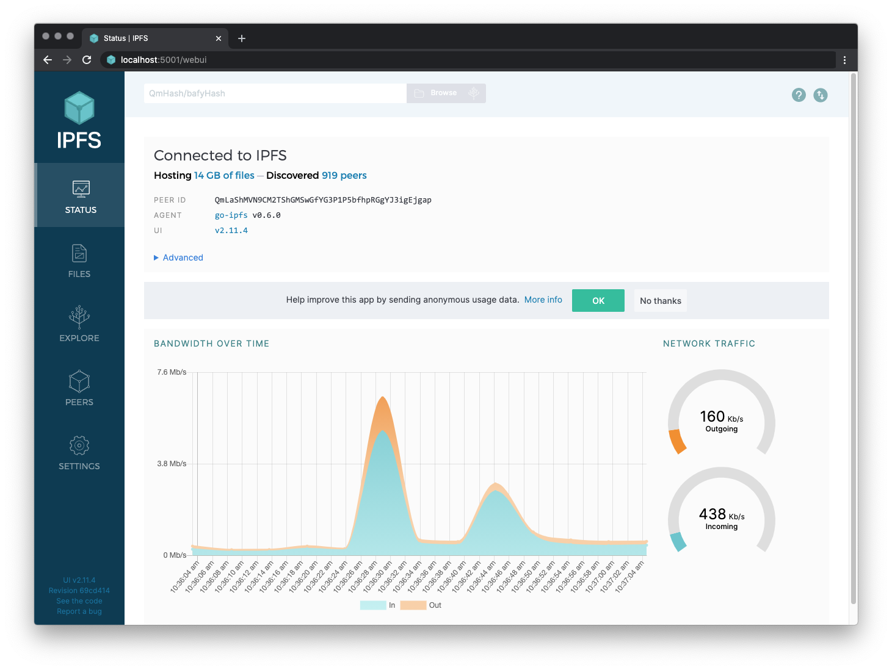

# Инициализиране на Kubo възел и взаимодействие с IPFS мрежата

В този урок ще инициализирате хранилище на IPFS Kubo възел, ще пуснете възела онлайн, ще взаимодействате с IPFS мрежата и ще видите уеб конзолата на локалния възел. Ако срещнете проблеми при следването на това ръководство, вижте [Отстраняване на проблеми](#troubleshooting).

## Предварителни изисквания

Ако все още не сте инсталирали Kubo, следвайте [ръководството за инсталиране на Kubo](../install/command-line.md).

## Инициализиране на хранилището

`ipfs` съхранява всичките си настройки и вътрешни данни в директория, наречена _хранилище_ (repository). Преди да използвате Kubo за първи път, ще трябва да инициализирате хранилището.

:::tip

- Ако стартирате Kubo на хост в публичния интернет (център за данни, VPS, облак), инициализирайте с профила `server`. Той забранява откриването в локалната мрежа и отказва libp2p връзки към и от адресни диапазони, които не са глобално маршрутизируеми, така че възелът не генерира трафик за откриване, който някои хостинг доставчици маркират като злоупотреба:

  ```bash
  ipfs init --profile server
  ```

  Вижте [референтния профил `server`](https://github.com/ipfs/kubo/blob/master/docs/config.md#server-profile) за пълен списък с филтри, редове за override и взаимодействието със reverse proxy (listener на `/ip4/127.0.0.1/tcp/.../ws`, поддържан от локален nginx или Caddy proxy, се нуждае от един от тези override, за да продължи да работи).

- Внимавайте при използване на `sudo` на Unix платформи (включително macOS)! Изпълнението на `sudo ipfs init` ще създаде хранилището за потребител `root`, вместо за вашия локален потребителски акаунт. Kubo не изисква root права, така че е най-добре да изпълнявате всички `ipfs` команди като обикновен потребител!
  :::

1. Отворете терминален прозорец.

1. Инициализирайте хранилището с командата `ipfs init`

   ```bash
   ipfs init
   ```

   Ще се покаже резултат, подобен на следния:

   ```bash
   > generating ED25519 keypair...done
   > peer identity: 12D3KooWMkNK8zgTQvtinDY8nuKmMAPBi3fBmvZj6W5huokJxekm
   > initializing IPFS node at /home/user/.ipfs
   ```

   :::tip
   `peer identity` е libp2p PeerID на вашия възел и ще се различава от този, показан в горния изход. Други възли в мрежата използват `peer identity`, за да ви открият и свържат с вас.

   Изпълнете `ipfs id`, за да покажете PeerID на вашия възел.
   :::

1. Изберете как Kubo ще превръща файловете в [CIDs](../concepts/content-addressing.md), като приложите import profile:

   ```bash
   ipfs config profile apply unixfs-v1-2025
   ```

   Import profile-ите определят как файловете се разделят на парчета и кодират, когато ги добавяте към вашия възел, което определя CIDs, които те произвеждат. Налични са два профила: [`unixfs-v1-2025`](https://github.com/ipfs/kubo/blob/master/docs/config.md#unixfs-v1-2025-profile), съвременният профил, препоръчан за нови проекти, и [`unixfs-v0-2015`](https://github.com/ipfs/kubo/blob/master/docs/config.md#legacy-cid-v0-profile) (алиас `legacy-cid-v0`) за проекти, които изискват обратно съвместим CIDv0. И двата са дефинирани в [IPIP-0499](https://specs.ipfs.tech/ipips/ipip-0499/) и произвеждат едни и същи CIDs в различни IPFS реализации.

   :::tip
   Ако зависите от факта, че вашите файлове ще произвеждат едни и същи CIDs през годините, изберете изричен import profile, както е показано по-горе. Неявните настройки могат да се променят между версиите на Kubo.

   Има цели набори от други конфигурационни опции, които можете да зададете; вижте [пълната справка](https://github.com/ipfs/kubo/blob/master/docs/config.md) за повече информация.
   :::

## Пускане на възела онлайн

След това пуснете възела онлайн и взаимодействайте с IPFS мрежата:

1. Отворете още един терминален прозорец.

2. Стартирайте IPFS демона в новия терминален прозорец:

   ```bash
   ipfs daemon
   ```

   След няколко момента ще се появи резултат, подобен на следния, завършващ с `Daemon is ready`:

   ```bash
   > Initializing daemon...
   > ...
   > RPC API server listening on /ip4/127.0.0.1/tcp/5001
   > WebUI: http://127.0.0.1:5001/webui
   > Gateway server listening on /ip4/127.0.0.1/tcp/8080
   > Daemon is ready
   ```

   Запишете TCP портовете от изхода. Ако са различни, използвайте вашите в командите по-долу.

   ::: danger НИКОГА НЕ ИЗЛАГАЙТЕ RPC API НА ПУБЛИЧНИЯ ИНТЕРНЕТ

   Портът на API (по подразбиране `5001`) предоставя достъп на администраторско ниво до вашия Kubo IPFS възел. Вижте [документите за RPC API v0](../reference/kubo/rpc.md) за повече информация.

   :::

3. Върнете се към първоначалния терминален прозорец.

4. Ако сте свързани към мрежата, изпълнете `ipfs swarm peers`, за да видите IPFS адресите на вашите връстници:

   ```bash
   ipfs swarm peers
   ```

   Ще се покаже изход, подобен на следния:

   ```bash
   > /ip4/192.0.2.10/udp/4001/quic-v1/p2p/12D3KooWGCbmjcHecEsV1ZqS2yBQa5Ayx2ho55ZGuqZ94iRCFRn2
   > /ip4/198.51.100.24/tcp/4001/p2p/12D3KooWLT8NHzZsjCVqurv5jFbGgqXnYS8iJLYxFojrY8KCCXtv
   > /ip4/203.0.113.9/udp/4001/quic-v1/p2p/12D3KooWCRbYM9TutELSMzxgVjToexLdhqixYjyZJ37k5NyJizEL
   > /ip4/203.0.113.201/tcp/4002/p2p/12D3KooWBt4YgEDqEW9fpDPqCBjPT82z9FR7mMP5XX7PNpDAFFJs
   ```

   Показаните адреси са [multiaddrs](../concepts/glossary.md#multiaddr), съставени от `<transport address>` (т.е. `/ip4/192.0.2.10/udp/4001/quic-v1`) и [`<peer-id>`](../concepts/glossary.md#peer-id) (т.е. `12D3KooWGCbmjcHecEsV1ZqS2yBQa5Ayx2ho55ZGuqZ94iRCFRn2`), което води до адрес във формата `<transport address>/p2p/<peer-id>`.

5. Сега, когато възелът е онлайн, извлечете приветствената страница на Kubo от мрежата с помощта на `ipfs cat`:

   ```bash
   ipfs cat /ipfs/bafybeie5nqv6kd3qnfjupgvz34woh3oksc3iau6abmyajn7qvtf6d2ho34/readme
   ```

   Трябва да видите нещо като това:

   ```
   Hello and Welcome to IPFS!

   ██╗██████╗ ███████╗███████╗
   ██║██╔══██╗██╔════╝██╔════╝
   ██║██████╔╝█████╗  ███████╗
   ██║██╔═══╝ ██╔══╝  ╚════██║
   ██║██║     ██║     ███████║
   ╚═╝╚═╝     ╚═╝     ╚══════╝

   If you're seeing this, you have successfully installed
   IPFS and are now interfacing with the ipfs merkledag!

    -------------------------------------------------------
   | Warning:                                              |
   |   This is alpha software. Use at your own discretion! |
   |   Much is missing or lacking polish. There are bugs.  |
   |   Not yet secure. Read the security notes for more.   |
    -------------------------------------------------------

   Check out some of the other files in this directory:

     ./about
     ./help
     ./quick-start     <-- usage examples
     ./readme          <-- this file
     ./security-notes
   ```

6. Файлът `quick-start` в същата директория изброява други примерни команди, които можете да изпробвате. За да го покажете, изпълнете:

   ```bash
   ipfs cat /ipfs/bafybeie5nqv6kd3qnfjupgvz34woh3oksc3iau6abmyajn7qvtf6d2ho34/quick-start
   ```

7. След това извлечете страхотна снимка на изстрелване на космически кораб от мрежата с помощта на `ipfs cat`:

   ```bash
   ipfs cat /ipfs/QmSgvgwxZGaBLqkGyWemEDqikCqU52XxsYLKtdy3vGZ8uq > ~/Desktop/spaceship-launch.jpg
   ```

   Когато горната команда се изпълни, Kubo търси в IPFS мрежата CID, посочен (`QmSgv...`), и записва данните във файл, наречен `spaceship-launch.jpg`.

8. Проверете, че снимка на изстрелване на космически кораб, наречена `spaceship-launch.jpg`, се намира в `~/Desktop`.

9. След това създайте файл, който да добавите към вашия възел:

   ```bash
   echo "meow" > meow.txt
   ```

10. Добавете `meow.txt` с помощта на `ipfs add`:

    ```bash
    ipfs add meow.txt
    ```

    Ще се покаже изход, подобен на следния:

    ```bash
    > added bafkreifq6dmp7dgjmwt3ocyh4ddljqbi6ezfs4mwv2ohbrrazopecncbay meow.txt
    ```

    Запишете CID (т.е. `bafkrei..`), защото ще ви потрябва в следващата стъпка.

11. Прегледайте файла през публичен gateway, като посочите CID `<CID>`, върнат в предишната стъпка:

    :::tip
    Примерът по-долу използва `curl` като браузър, но вие можете да използвате всеки инструмент, способен да изпраща HTTP заявки.
    :::

    ```bash
    curl "https://ipfs.io/ipfs/<CID>"
    ```

    Ще се покаже изход, подобен на следния:

    ```bash
    > meow
    ```

    В тази стъпка gateway сервира файл _от вашия компютър_. Gateway попита distributed hash table (DHT), намери вашия компютър, поиска файла, вашият компютър го изпрати на gateway, а gateway го изпрати до браузъра.

12. Прегледайте файла на собствения си локален gateway:

    ```bash
    curl "http://127.0.0.1:8080/ipfs/<CID>"
    ```

    ```bash
    > meow
    ```

    По подразбиране вашият gateway не е изложен навън. Работи само локално.

## Взаимодействие с отдалечен възел

По подразбиране CLI командите говорят с демона, работещ на локалния ви компютър. Ако демонот работи на различна машина или в контейнер, има два начина за свързване към него.

### Използване на флага --api

Използвайте флага `--api`, за да посочите отдалечения адрес на API:

```bash
ipfs --api /ip4/192.168.1.100/tcp/5001 id
```

Адресът използва формат [multiaddr](../concepts/glossary.md#multiaddr). Някои често срещани примери:

- `/ip4/192.168.1.100/tcp/5001` - IPv4 адрес в доверена локална мрежа
- `/ip6/::1/tcp/5001` - IPv6 loopback (localhost)
- `/dns/node.example.com/tcp/443/https` - DNS име с TLS (за публичен интернет)

:::warning Излагане на RPC API на публичния интернет
Когато се свързвате през недоверени мрежи, винаги използвайте TLS (`/https`) и автентикация (`--api-auth`). Вижте [Securing Kubo RPC API](kubo-rpc-tls-auth.md) за инструкции за настройка.
:::

### Използване на файла `api`

За да избегнете подаването на `--api` към всяка команда, създайте файл `api` в хранилището на IPFS, съдържащ multiaddr на отдалечения API:

```bash
echo "/ip4/192.168.1.100/tcp/5001" > ~/.ipfs/api
```

Сега всички команди ще използват отдалечения възел:

```bash
ipfs id
```

:::tip
Kubo автоматично създава `$IPFS_PATH/api`, когато стартира `ipfs daemon`. Можете също да създадете този файл ръчно, за да се свържете към:

- Kubo възел, работещ в Docker или друг контейнер
- отдалечен сървър, изпълняващ `ipfs daemon`
- възел на [IPFS Desktop](../install/ipfs-desktop.md) (файлът `api` се създава автоматично в `~/.ipfs/api`)

Флагът `--api` има предимство пред файла `api`.
:::

:::tip Read-only access
Ако имате нужда само да извличате съдържание без pinning или добавяне на файлове, помислете за използване на [HTTP Gateway](../reference/http/gateway.md) вместо това.
:::

## Взаимодействие с възела чрез уеб конзолата

Можете да видите уеб конзолата на локалния си възел, като отидете на `localhost:5001/webui`.



Уеб конзолата показва файловете, които са в вашата [Mutable File System (MFS)](../concepts/file-systems.md#mutable-file-system-mfs). MFS е инструмент, вграден в уеб конзолата, който помага да се навигира в IPFS файлове по същия начин, както в стандартна файлова система, базирана на имена.

Когато добавяте файлове с помощта на [CLI команда `ipfs add ...`](../reference/kubo/cli.md#ipfs-add), тези файлове не се появяват автоматично в MFS. За да видите файлове в уеб конзолата, които сте добавили с CLI, трябва да ги копирате в MFS:

1. Въведете `localhost:5001/webui` в браузъра, за да видите уеб конзолата.

1. В левия страничен панел кликнете **Files**. Показва се празна директория заедно със следното съобщение:

   ```plaintext
   No files here yet! Add files to your local IPFS node by clicking the Import button above.
   ```

1. Върнете се към първоначалния терминален прозорец.

1. Използвайки CID `<CID>`, получен при добавянето на `meow.txt` към възела в предишната стъпка, копирайте файловете в MFS.

   ```shell
   ipfs files cp /ipfs/<CID> /meow.txt
   ```

   Например, ако `<CID>` на `meow.txt` е `bafkreifq6dmp7dgjmwt3ocyh4ddljqbi6ezfs4mwv2ohbrrazopecncbay`, той ще бъде копиран в MFS със:

   ```shell
   ipfs files cp /ipfs/bafkreifq6dmp7dgjmwt3ocyh4ddljqbi6ezfs4mwv2ohbrrazopecncbay /meow.txt
   ```

1. В браузъра обновете страницата **Files**. Списъкът с файлове показва `meow.txt`.

## Използване на IPFS Companion с Kubo

Можете да използвате IPFS Companion, браузърно разширение, което опростява достъпа до IPFS ресурси и добавя поддръжка за IPFS протокола, за да пренасочва автоматично IPFS gateway заявките към локалния демон, така че да не разчитате на отдалечени gateways.

За повече информация за IPFS Companion, включително как да го инсталирате, вижте [IPFS Companion quickstart](../install/ipfs-companion.md).

## Отстраняване на проблеми

### Проверете версията на Go

Компилирането на Kubo от източник изисква Go версия, посочена в файла [`go.mod`](https://github.com/ipfs/kubo/blob/master/go.mod) или по-нова. За да проверите коя версия на Go имате инсталирана, въведете `go version`:

```bash
go version

> go version go1.26.5 linux/amd64
```

Ако трябва да актуализирате, препоръчваме да инсталирате от [официалните Go пакети](https://go.dev/doc/install). Мениджърите на пакети често съдържат остарели Go пакети.

### Проверете дали FUSE е инсталиран

Трябва да инсталирате и настроите FUSE, за да монтирате файлова система. За повече подробности за настройката на FUSE, вижте [github.com/ipfs/kubo/blob/master/docs/fuse.md](https://github.com/ipfs/kubo/blob/master/docs/fuse.md)

### Допълнителна помощ

IPFS общността е дружелюбна и може да помогне! [Получете поддръжка от други IPFS разработчици в IPFS форума](../community/README.md#get-technical-support-and-help), или се присъединете към [чат каналите на общността](../community/README.md#chat).
