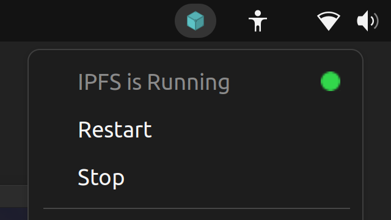
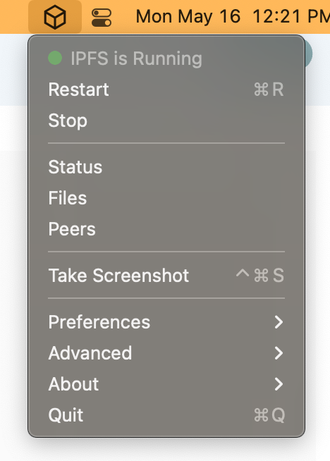
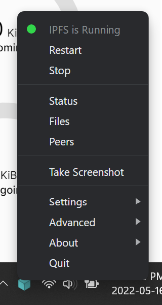
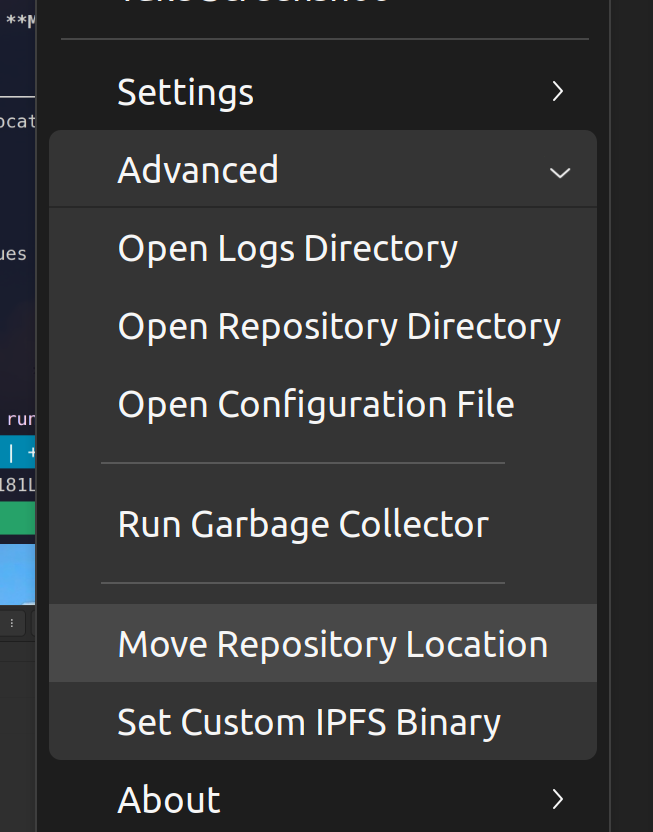
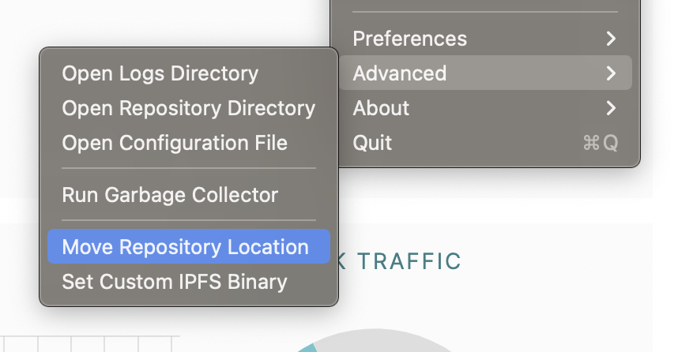
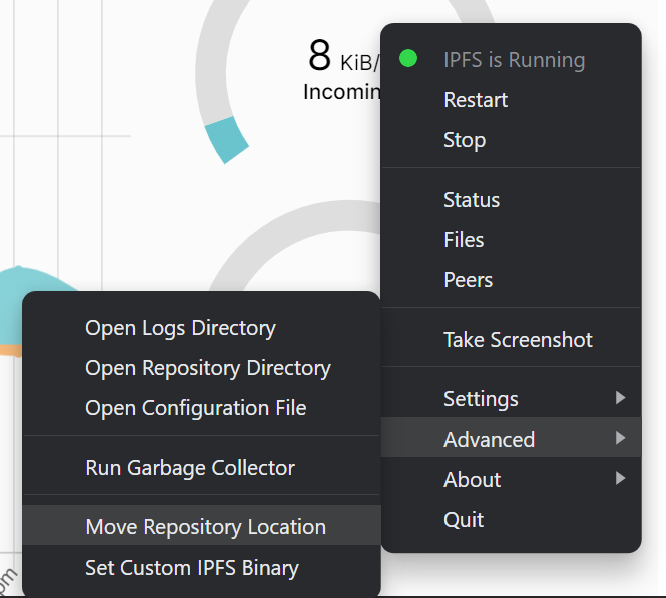

# Преместване на инсталацията на IPFS

Тази страница описва как да преместите инсталацията на IPFS от една система в друга. Този процес е съвместим между различни платформи и е особено полезен за читатели, които сменят операционна система. Въпреки това, процесът е различен за потребители на CLI и IPFS Desktop.

- [Команден ред](#command-line)
- [IPFS Desktop](#ipfs-desktop)
- [Symbolic link](#symlink)

## Команден ред

Процесът е следният: вземате папката `.ipfs` от _home_ директорията на _донор_ системата и я копирате в _home_ директорията на получаващата система.

Този процес не е процедура за архивиране; не го третирате като такава. Много неща могат да се объркат, повечето от които се отнасят до _peer IDs_. Тъй като дублираме папката с инсталацията `.ipfs`, и двата IPFS peer-а ще имат един и същ peer ID. Този проблем е приемлив, стига да изтриете старата _донор_ инсталация веднага след завършването на копирането. Никога не стартирайте два peer-а със същия peer ID на различни места, защото те ще започнат да се държат некоректно.

### Преместване на инсталацията

Най-лесният начин да преместите инсталацията на IPFS е да вземете папката `.ipfs` и да я преместите на друго място.

#### Linux и macOS

1. Спирайте всички IPFS daemons, services или приложения, които в момента работят.
1. В терминал, преминете към мястото, където е съхранено хранилището на IPFS. Това най-вероятно е вашата _home_ папка:

   ```shell
   cd ~/
   ```

1. Направете копие на директорията `.ipfs`:

   ```shell
   cp --recursive --verbose $([[ -z $(cp --help | grep "\-\-reflink" | head -n1) ]] || echo -n "--reflink=auto") .ipfs ipfs-backup
   ```

   Това ще изведе нещо като:

   ```plaintext
   '.ipfs' -> 'ipfs-backup'
   '.ipfs/datastore_spec' -> 'ipfs-backup/data'
   ...
   ```

   По-горната команда проверява дали текущата операционна система поддържа `cp --reflink`. Ако да, както в повечето Linux операционни системи, тогава тази команда ще използва аргумента `--reflink` при извикване на `cp`. Ако операционната система не поддържа аргумента `--reflink`, като macOS, тогава няма да го използва.

1. Сега имате копие на хранилището на IPFS във папката `ipfs-backup`.

#### Windows

1. Спирайте всички IPFS daemons, services или приложения, които в момента работят.
1. Отворете File Explorer и отидете в `C:\Users\ВАШЕТО ПОТРЕБИТЕЛСКО ИМЕ`, като замените _ВАШЕТО ПОТРЕБИТЕЛСКО ИМЕ_ с текущото ви Windows потребителско име.
1. Изберете раздела **View** в горната част на прозореца на File Explorer и отметнете **Hidden items**.
1. Намерете `.ipfs` в потребителската _home_ папка. Обикновено това е `C:\Users\ВАШЕТО_ПОТРЕБИТЕЛСКО_ИМЕ\.ipfs`.
1. Копирайте тази папка на удобно място, например на `Desktop`, и я преименувайте на `ipfs-backup`.

### Възстановяване на инсталацията

След като имате резервно копие на хранилището на IPFS в `ipfs-backup`, можете да го преместите на желаното място за възстановяване. След това можете да възстановите хранилището на IPFS.

#### Linux и macOS

1. Спирайте всички IPFS daemons, services или приложения, които в момента работят.
1. В терминал, преминете към мястото, където е съхранено хранилището на IPFS. Това най-вероятно е вашата _home_ папка `~`:

   ```shell
   cd ~/
   ```

1. Преместете текущото си хранилище на IPFS в друга папка. Ако нещо се обърка, можете да възстановите инсталацията от тук:

   ```shell
   mv .ipfs ~/ipfs-old
   ```

1. Преместете резервното копие на IPFS хранилището в `.ipfs`:

   ```shell
   mv ipfs-backup ~/.ipfs
   ```

1. Стартирайте IPFS daemon:

   ```shell
   ipfs daemon
   ```

1. Вашият IPFS daemon трябва да продължи оттам, където е спрял.
1. След като потвърдите, че всичко работи нормално, можете да изтриете временната резервна копия `ipfs-old`:

   ```shell
   rm -rf ~/ipfs-old
   ```

#### Windows

1. Ако възстановявате в приложението IPFS Desktop, отворете приложението поне веднъж, преди да опитвате да възстановите нещо.
1. Спирайте всички IPFS daemons, services или приложения, които в момента работят.
1. Отворете File Explorer и отидете в `C:\Users\ВАШЕТО_ПОТРЕБИТЕЛСКО_ИМЕ`.
1. Изберете раздела **View** в горната част на прозореца на File Explorer и отметнете **Hidden items**.
1. Намерете `.ipfs` в потребителската _home_ папка. Пълният адрес обикновено е нещо като `C:\Users\ВАШЕТО_ПОТРЕБИТЕЛСКО_ИМЕ\.ipfs`.
1. Преименувайте папката `.ipfs` на `ipfs-old`. Можем да възстановим от `ipfs-old`, ако нещо се обърка.
1. Копирайте вашето резервно копие `ipfs-backup` на хранилището на IPFS в папката на потребителя и го преименувайте на `.ipfs`.
1. Отворете приложението IPFS Desktop или стартирайте `ipfs daemon` с PowerShell. Всичко трябва да стартира и хранилището на IPFS да се възстанови нормално.

### Windows Subsystem for Linux

Ако имате инсталиран IPFS в Windows Subsystem for Linux, можете да преместите хранилището на IPFS от Linux в вашата Windows среда. Този процес презаписва хранилището на IPFS в Windows.

1. В Windows отворете приложението IPFS Desktop или стартирайте `ipfs daemon`. Направете това поне веднъж.
1. Спирайте всички IPFS daemons, services или приложения, които работят и в Linux, и в Windows средата.
1. Копирайте хранилището на IPFS от Linux в Windows. Този процес презаписва хранилището на IPFS в Windows:

   ```shell
   cp --recursive --verbose ~/.ipfs /mnt/c/Users/Your Username/
   ```

1. В Windows отворете приложението IPFS Desktop или стартирайте `ipfs daemon`. Всичко трябва да се отвори успешно.

## IPFS Desktop

Следвайте тези стъпки, за да преместите инсталацията на IPFS с помощта на приложението IPFS Desktop.

1. Изберете менюто на IPFS Desktop tray.

   | Linux                                                               | macOS                                                       | Windows                                                         |
   | ------------------------------------------------------------------- | ----------------------------------------------------------- | --------------------------------------------------------------- |
   |  |  |  |

1. Изберете **Advanced** → **Move Repository Location**.

   | Linux                                                                                       | macOS                                                                               | Windows                                                                                 |
   | ------------------------------------------------------------------------------------------- | ----------------------------------------------------------------------------------- | --------------------------------------------------------------------------------------- |
   |  |  |  |

1. Изберете новото местоположение на IPFS във файловия браузър.
1. IPFS ще спре, ще премести хранилището към новото местоположение и ще се стартира отново. Ако имате хранилище по-голямо от 1 GiB, може да отнеме няколко момента, за да се премести в новото местоположение.

## Symlink

Друг подход за преместване на хранилището на IPFS е просто да създадете symlink в оригиналното местоположение, който сочи към новото местоположение. По този начин не се налага да се променя конфигурацията, така че инструменти и приложения като IPFS Desktop ще работят нормално.

### Linux и macOS

Unix-базираните операционни системи могат да използват командата `ln -s`, за да създадат символна връзка. След като преместите хранилището в новото местоположение, създайте връзката в оригиналното местоположение:

```shell
ln -s ~/new-ipfs-repo ~/.ipfs
```

### Windows

Потребителите на Windows могат да използват командата `mklink`, за да създадат символна връзка. Тази команда е налична в command-prompt (cmd.exe); от PowerShell я стартирайте чрез `cmd /c`:

```powershell
mklink /D "C:\Users\ВАШЕТО_ПОТРЕБИТЕЛСКО_ИМЕ\.ipfs" "C:\New IPFS Repo"
```

Уверете се, че сте заменили `ВАШЕТО_ПОТРЕБИТЕЛСКО_ИМЕ` с името на потребителя, в който сте влезли в момента.

## Отстраняване на проблеми

Ето някои често срещани проблеми, които може да срещнете при преместване на инсталацията на IPFS.

### Linux и macOS

#### IPFS daemon не стартира успешно

Ако `ipfs daemon` не стартира успешно, можете да възстановите старото хранилище на IPFS, при условие че сте направили копие:

```shell
mv .ipfs ipfs-backup-broken
mv ~/ipfs-old ~/.ipfs
```

Стартирането на `ipfs daemon` сега зарежда старото ви IPFS хранилище. Опитайте да повторите стъпките за резервно копие и възстановяване. Уверете се, че спрете всички IPFS services, daemons или приложения, когато правите резервно копие и възстановяване на хранилище на IPFS.

#### Някои данни от старата инсталация липсват в новата

Ако преди сте изпълнявали някои `ipfs` команди с `sudo`, например `sudo ipfs get $someCID`, командата `ipfs` може да е създала ново IPFS хранилище за потребителя `root`, отделно от това за вашия потребителски акаунт.

Ако имате `root` / `sudo` достъп до старата система, проверете дали съществува директорията `/root/.ipfs`. Ако да, направете резервно копие на директорията `/root/.ipfs`, както е описано по-горе.

Ако искате да консолидирате двете хранилища, можете да експортирате IPFS обектите от едно хранилище в набор от CAR файлове и да ги импортирате в друго хранилище.

По-долу е кратък bash фрагмент за експортиране на всички локални IPFS обекти в набор от файлове в директория, наречена `car_export`. Тези команди трябва да се изпълняват като потребителят, който притежава хранилището, което искате да експортирате, и IPFS daemon трябва да работи.

```shell
mkdir -p car_export
cd car_export
cids=$(ipfs refs local)
for cid in $cids; do
  echo "exporting $cid"
  ipfs dag export $cid > $cid.car
done
```

След това ще можете да импортирате тези файлове в нова IPFS инсталация, използвайки команда като тази:

```shell
cd car_export
ipfs dag import *.car
```

### Windows

#### IPFS Desktop има грешка

Уверете се, че сте отворили приложението IPFS Desktop поне веднъж, преди да опитвате да преместите някое IPFS хранилище. IPFS Desktop разчита и на друга директория, наречена `.ipfs-desktop`. Преместването понякога се проваля, ако тази папка не съществува.

#### IPFS Desktop няма да се отвори

В потребителската _home_ папка преименувайте `.ipfs` и `.ipfs-desktop` на `ipfs-broken` и `ipfs-desktop-broken` съответно. Отворете приложението IPFS Desktop; това създава нови `.ipfs` и `.ipfs-desktop` папки. Затворете приложението IPFS Desktop и заменете `.ipfs` с `ipfs-broken`. Ако приложението IPFS Desktop се отвори, тогава вече знаете, че оригиналната папка `.ipfs-desktop` е била проблемът. Ако приложението IPFS Desktop не се отвори, тогава оригиналната папка `.ipfs` може да е проблемът. Ако и двете оригинални папки причиняват проблеми, може да имате повредена база данни. Ако това е случаят, публикувайте вашия проблем в [IPFS форумите](https://discuss.ipfs.tech/).
