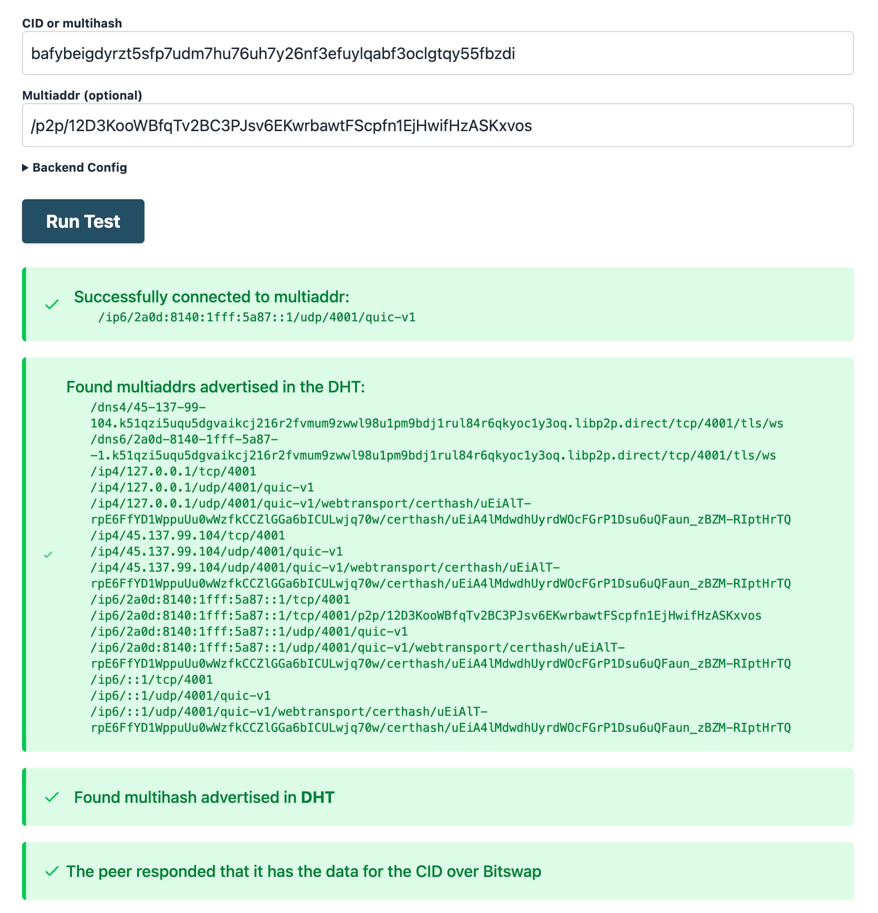

# Въведение в отстраняването на проблеми с IPFS

От високо ниво, отстраняването на проблеми в IPFS обикновено се свежда до намиране на основната причина за проблем в една от следните операции:

- [**Извличане**](#troubleshooting-retrieval) - Извличане на данни по CID от други peers в мрежата.
- [**Предоставяне**](#troubleshooting-providing) - Предоставяне на данни на други peers в мрежата.

Извличането и предоставянето са допълващи се операции, тъй като едната не може да се извърши без другата. Следователно техните режими на повреда са тясно свързани и могат да бъдат приписани на следните причини:

- **Content routing**: доставчиците за CID не могат да бъдат намерени в DHT или IPNI.
- **Мрежова свързаност**: свързването с доставчик не е възможно, защото доставчикът е офлайн или недостъпен през мрежата.

Това ръководство описва техники за отстраняване на проблеми и идентифициране на основната причина за често срещани проблеми с извличането и предоставянето в [публичната IPFS Mainnet](../concepts/glossary.md#mainnet) мрежа.

За целите на това ръководство ще използваме следните инструменти:

- [IPFS Check](https://check.ipfs.network) - Browser-based debugging tool, който може да помогне за идентифициране на основната причина за проблем с извличането.
- [Kubo](https://github.com/ipfs/kubo) - Популярна реализация на IPFS с CLI, която може да се използва за отстраняване на проблеми с извличането и предоставянето от терминал.
- [Helia Identify tool](https://ipfs.fyi/identify) - Browser-based tool за стартиране на [libp2p identify](https://github.com/libp2p/specs/blob/master/identify/README.md) с даден peer id, проверявайки дали peer-ът е dialable от браузър.
- [Public Delegated Routing Endpoint](../concepts/public-utilities.md#delegated-routing-endpoint) на `https://delegated-ipfs.dev/routing/v1` - който може да се използва за намиране на доставчици за CID.

## Отстраняване на проблеми с извличането

В този раздел ще научите как да отстранявате често срещани проблеми с извличането. За по-подробен преглед на процеса на извличане, вижте [жизнения цикъл на данните в IPFS](../concepts/lifecycle.md#3-retrieving).

### Отстраняване на проблеми при извличане от публични recursive IPFS gateways

Ако отстранявате проблеми при извличане от [публичен recursive IPFS gateway](../concepts/ipfs-gateway.md#recursive-vs-non-recursive-gateways), имайте предвид, че gateway е просто друг IPFS възел и допълнителна точка на провал, за която обикновено нямате представа. Това означава, че е по-трудно да се отстраняват проблеми, защото като потребител не можете да установите дали проблемът е в gateway-а или в provider възела.

Затова се препоръчва използването на Kubo или IPFS Check за отстраняване на проблеми с извличането, тъй като те дават директен поглед върху възможността за извличане на данните по CID от доставчици.

### Какви са причините за неуспешно извличане на данни по CID?

Когато не успеете да извлечете данните за даден CID, има главни класове грешки, които могат да бъдат причината:

- Content routing: доставчици за CID не могат да бъдат намерени в DHT или IPNI:
  - Защото няма доставчици за CID.
  - Защото доставчиците не обявяват CID в DHT или IPNI.
  - Защото има проблеми с [DHT](https://discuss.ipfs.tech/t/incident-report-increased-latency-on-the-amino-dht/17338) или [IPNI](https://blog.ipfs.tech/newsletter-205/#ipni-service-update).
- Свързаност:
  - Доставчикът е офлайн или недостъпен през мрежата поради NAT или firewall проблеми.
  - Доставчикът не е dialable от браузъри:
    - Защото доставчикът няма публичен IP.
    - Защото доставчикът не поддържа browser transports като Secure WebSockets, WebTransport или WebRTC.

В следващия раздел ще научите как да използвате delegated routing endpoint за проверка на доставчиците за CID и как да получите по-подробен преглед на основната причина с IPFS Check.

### Проверка на доставчиците чрез Delegated Routing Endpoint

За бърз преглед на доставчиците за даден CID и от DHT, и от IPNI, можете да използвате [Delegated Routing Endpoint](../concepts/public-utilities.md#delegated-routing-endpoint) на `https://delegated-ipfs.dev/routing/v1`, който можете да попитате с обикновен HTTP GET request.

Например, отворете [`delegated-ipfs.dev/routing/v1/providers/bafybeigdyrzt5sfp7udm7hu76uh7y26nf3efuylqabf3oclgtqy55fbzdi`](https://delegated-ipfs.dev/routing/v1/providers/bafybeigdyrzt5sfp7udm7hu76uh7y26nf3efuylqabf3oclgtqy55fbzdi) в браузъра.

Или използвайте `curl` за query към endpoint-а:

```shell
curl -H "Accept: application/x-ndjson" "https://delegated-ipfs.dev/routing/v1/providers/bafybeigdyrzt5sfp7udm7hu76uh7y26nf3efuylqabf3oclgtqy55fbzdi"
```

> _Бележка_: Като зададете Accept header на `application/x-ndjson`, отговорът ще бъде stream-нат, така че няма да се налага да чакате целия отговор, преди да започнете обработката на резултатите.

Ако body на отговора съдържа масив от доставчици с Peer IDs и Multiaddrs и друга информация, [както е дефинирано в спецификацията](https://specs.ipfs.tech/routing/http-routing-v1/#known-schemas), можете да преминете към следващия раздел, за да отстранявате проблеми с извличането чрез IPFS Check.

Ако получите HTTP 200 отговор без доставчици (празно тяло при използване на `application/x-ndjson` Accept header, показан по-горе, или `{"Providers":[]}` в стандартния JSON отговор), вижте секцията [No providers returned](#no-providers-returned) за повече информация. Някои по-стари routing endpoints сигнализират същия резултат с HTTP 404 response, което клиентите трябва да интерпретират като нулеви резултати.

### Отстраняване на проблеми с извличането чрез IPFS Check

[IPFS Check](https://check.ipfs.network) е уеб приложение, което помага при отстраняване на проблеми с извличането по CID.

То помага да отговори на следните въпроси:

1. Колко доставчици за този CID бяха открити в IPFS Mainnet?
1. В коя routing система е открит всеки от тези доставчици, Amino DHT или IPNI?
1. Дали данните за CID са извлекаеми от доставчиците, които ги обявяват?
1. Дали данните за CID са извлекаеми чрез Bitswap и/или HTTP?
1. Какви multiaddresses и network transports се използват за свързване към успешните доставчици за CID?
1. Дали е била необходима NAT hole punching, за да се извлекат данните?

IPFS Check се състои от frontend, който взаимодейства с backend. Backend е набор от Go библиотеки, използвани за query към DHT и IPNI, и за probing на извличане от доставчиците за даден CID. Frontend е уеб приложение, което позволява взаимодействие с backend и визуализация на резултатите.

@[youtube](XeNOQDOrdC0)

### Режими на работа на IPFS Check

IPFS Check поддържа два режима на работа:

1. **Multi-provider check**: подавате CID и IPFS Check ще търси доставчици и в IPNI, и в DHT, и ще върне резултати за възможност за извличане от множество доставчици.
2. **Provider-specific check**: подавате CID и multiaddr или peer id на доставчик, с `/p2p/` отпред.

### Provider-specific checks с IPFS Check

1. Отворете инструмента [IPFS Check](https://check.ipfs.network/).
2. В полето **CID** въведете CID, който се опитвате да проверите.
3. В полето **Multiaddr** въведете multiaddress (или Peer ID, или пълен multiaddr) на IPFS peer-а, който проверявате.
4. Кликнете **Run Test**.

Полето **Multiaddr** може да бъде:

- Само Peer ID, с `/p2p/` отпред, например `/p2p/12D3KooWBgwLwbTX5YYgASx8sqv49WBhy9gzLCLFVCP9jshfVdC5`. IPFS Check ще route-не Peer ID, за да намери пълния multiaddr.
- Пълен multiaddr, например `/ip4/1.1.1.1/tcp/4001/p2p/12D3KooWBgwLwbTX5YYgASx8sqv49WBhy9gzLCLFVCP9jshfVdC5`.

Например, резултатът ще изглежда така при provider-specific check за CID:



Като разгледате изхода, можете да знаете следното:

- Доставчикът и CID бяха routable чрез DHT.
- Доставчикът е онлайн и данните за CID са извлекаеми чрез Bitswap.
- Доставчикът беше достъпен чрез IPv6 с QUIC transport, и също така поддържа Secure WebSockets (multiaddr с `dn
