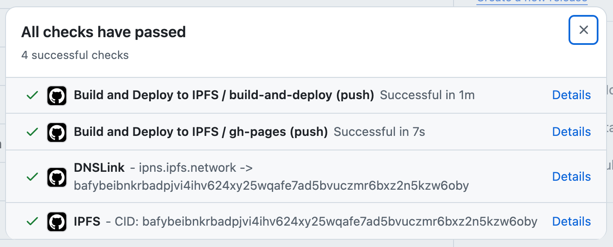
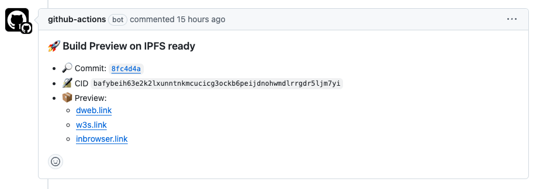
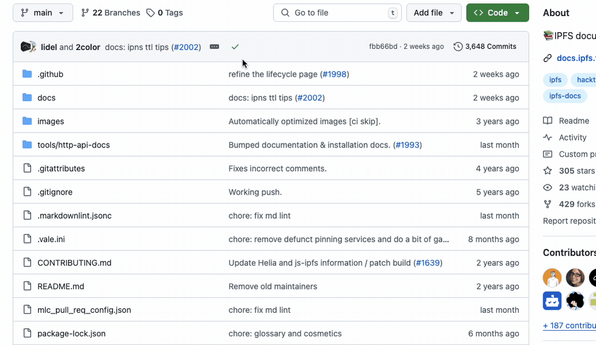

# Деплой на статични приложения в IPFS с GitHub Actions

Това ръководство ще ви преведе през процеса на конфигуриране на workflow за [GitHub Actions](https://docs.github.com/en/actions), който разгръща хранилище, съдържащо статичен сайт или приложение, в IPFS с помощта на [IPFS Deploy Action](https://github.com/ipshipyard/ipfs-deploy-action).

В края на това ръководство вашето уеб приложение (или просто статичен уебсайт) ще бъде автоматично разгръщано в IPFS, когато изпълните push към вашето хранилище. То също така ще създава preview-и за pull request-ове за всеки commit и ще предоставя допълнителни функционалности за разработчици, като актуализации на commit status с CID на билд-а и коментар в pull request-овете с IPFS CID и връзки за preview.





След разгръщането всяка версия на приложението ще бъде адресирана чрез CID и достъпна чрез [рекурсивни gateway-ове](https://docs.ipfs.tech/concepts/ipfs-gateway/#recursive-vs-non-recursive-gateways), както и чрез [Service Worker Gateway](https://inbrowser.link).

За да видите как това изглежда в реален пример, разгледайте [IPNS Inspector](https://github.com/ipshipyard/ipns-inspector).

## Какво представлява IPFS Deploy Action?

[IPFS Deploy Action](https://github.com/ipshipyard/ipfs-deploy-action) е [composite action](https://docs.github.com/en/actions/creating-actions/creating-a-composite-action), който извиквате като стъпка в [GitHub Actions workflow](https://docs.github.com/en/actions/writing-workflows). Той отговаря за един етап от деплоя: превръщането на вашия билд в [CAR](../../concepts/glossary.md#car) файл с детерминиран root CID.

- 📦 Марклеизира вашия статичен сайт в CAR файл
- 🚀 Закачва CAR към ваш собствен [IPFS Cluster](https://ipfscluster.io/) или [Kubo](https://github.com/ipfs/kubo#readme) възел, когато конфигурирате такъв
- 🧩 Предава същия CAR на всяка трета pinning услуга като следваща стъпка
- 💬 PR preview-и с коментар, съдържащ CID и връзки за preview
- ✅ Актуализации на commit status

Тъй като CAR-файлът е готов преди някой трети участник да го види, pinningът е композируем. Услугата за pinning съхранява байтовете; тя не извежда отново CID. Можете да подадете един CAR на произволен брой услуги.

Action-ът не прави предположения за вашия build процес. Независимо дали използвате React, Vuepress, Astro, Next.js или друг генератор на статични сайтове, това ръководство е приложимо. Единственото изискване е приложението да е статично: след build-а то представлява папка с HTML, CSS и JavaScript, която се сервира „както е” към клиента.

## Предварителни изисквания

Преди да започнете, се уверете, че имате:

1. GitHub хранилище с вашето статично уеб приложение. Това може да бъде SPA приложение или многостранично приложение (като Next.js), което не изисква server-side rendering или backend логика.
2. Място, където да pin-нете резултата. Или собствен IPFS възел ([Kubo](https://github.com/ipfs/kubo#readme) или [IPFS Cluster](https://ipfscluster.io/)) с публично достъпен [Kubo RPC](../../reference/kubo/rpc.md) endpoint (вижте [securing the Kubo RPC endpoint](../kubo-rpc-tls-auth.md)), или акаунт в трета pinning услуга.

Pinningът е незадължителен. Можете да започнете и без него: action-ът все още създава CAR файл и го прикрепя към workflow run-а, което е достатъчно, за да проверите CID преди да се ангажирате с provider.

## Стъпка 1: Създаване на CAR

Създайте нов файл `.github/workflows/deploy.yml` в хранилището си:

```yaml
name: Deploy to IPFS

permissions:
  contents: read
  pull-requests: write
  statuses: write

on:
  push:
    branches:
      - main
  pull_request:

jobs:
  deploy:
    runs-on: ubuntu-latest
    steps:
      - name: Checkout code
        uses: actions/checkout@v4

      - name: Setup Node.js
        uses: actions/setup-node@v4
        with:
          node-version: 'lts/*'
          cache: 'npm'

      - name: Install dependencies
        run: npm ci

      - name: Build project
        run: npm run build

      - name: Deploy to IPFS
        uses: ipshipyard/ipfs-deploy-action@v3
        id: deploy
        with:
          path-to-deploy: dist # Change this to your build output directory
          github-token: ${{ github.token }}
```

Няколко неща, които трябва да имате предвид:

- Този workflow предполага, че build командата е `npm run build`. Ако е различна, променете `run` командата в стъпката за build.
- Задайте `path-to-deploy` на директорията, в която вашият build записва файловете, например `dist`, `out`, `public` или `_site`.

След като зададете само `path-to-deploy` и `github-token`, action-ът създава CAR и спира. Root CID е достъпен като output `cid`, а пътят до файла като `car-path`, така че следващите стъпки могат да го pin-нат. PR коментарите и commit status остават тихи, докато не pin-нете някъде или не зададете `set-pr-comment` и `set-github-status` изрично.

Ако хранилището ви приема pull request-ове от fork-ове, secrets не са налични за build-овете от fork-ове. Вместо това използвайте [dual-workflow setup](https://github.com/ipshipyard/ipfs-deploy-action#dual-workflows-with-fork-prs), който разделя build-а и деплоя.

## Стъпка 2: Pin-ване на CAR

### Pin-ване към собствен възел

Action-ът поддържа нативно pin-ване към IPFS Cluster и Kubo. Добавете данните си като [GitHub secrets](https://docs.github.com/en/actions/security-for-github-actions/security-guides/using-secrets-in-github-actions), след което ги предайте.

За IPFS Cluster:

```yaml
- name: Deploy to IPFS
  uses: ipshipyard/ipfs-deploy-action@v3
  with:
    # ... other inputs ...
    cluster-url: ${{ secrets.CLUSTER_URL }}
    cluster-user: ${{ secrets.CLUSTER_USER }}
    cluster-password: ${{ secrets.CLUSTER_PASSWORD }}
```

За Kubo възел, използващ неговия [RPC endpoint](https://github.com/ipfs/kubo/blob/master/docs/config.md#addressesapi) и [API token](https://github.com/ipfs/kubo/blob/master/docs/config.md#apiauthorizations):

```yaml
- name: Deploy to IPFS
  uses: ipshipyard/ipfs-deploy-action@v3
  with:
    # ... other inputs ...
    kubo-api-url: ${{ secrets.KUBO_API_URL }}
    kubo-api-auth: ${{ secrets.KUBO_API_AUTH }}
```

Конфигурирайте provider-а изцяло или изобщо не. Задаването на `cluster-url` без `cluster-user` и `cluster-password` е hard error, а не тихо пропускане; същото правило важи и за двата Kubo input-а.

За пълен списък с опции за настройка, включително `kubo-version`, `cid-profile`, pin expiry и retry behavior, вижте [Inputs](https://github.com/ipshipyard/ipfs-deploy-action#inputs) в README на action-а.

### Pin-ване чрез трета услуга

Pin-ването чрез трета услуга е следваща стъпка, която използва CAR-а, създаден от action-а. Всеки от рецептите по-долу може да се копира и постави и чете `steps.deploy.outputs.car-path` и `steps.deploy.outputs.cid`:

- [Filecoin чрез `filecoin-pin` CLI](https://github.com/ipshipyard/ipfs-deploy-action/blob/main/docs/recipes/filecoin-pin.md)
- [Pinata чрез V3 Files API](https://github.com/ipshipyard/ipfs-deploy-action/blob/main/docs/recipes/pinata.md)
- [Filebase чрез S3 endpoint](https://github.com/ipshipyard/ipfs-deploy-action/blob/main/docs/recipes/filebase.md)

CAR-файлът се качва и като workflow artifact по default, така че стъпка за pin-ване може да се изпълни в отделен job, който да го изтегли.

## Достъп до вашия деплойнат сайт

След успешен деплой можете да намерите CID за commit:

1. В изхода на GitHub Actions run-а
2. В PR коментара, ако деплоят идва от PR
3. В commit status check-овете

Например, така можете да намерите CID за конкретен commit в GitHub:



Можете да заредите приложението, използвайки CID от commit status-а, и то ще бъде достъпно през:

- [Public Good Gateway](../../concepts/public-utilities.md#public-ipfs-gateways): `https://<CID>.ipfs.dweb.link`
- [Service Worker Gateway](https://inbrowser.link): `https://<CID>.ipfs.inbrowser.link`

Ако вашата pinning услуга има собствен gateway, това също ще работи.

### С IPFS Desktop или Kubo

Ако имате инсталирани IPFS Desktop или Kubo, можете да заредите сайта през локалния gateway, който те предоставят.

Например, ето URL за конкретен CID: `http://bafybeicbpllqfrjfygcdwkz2q5prdtu4q7obmsqr2fkk5byn45rs24ypcu.ipfs.localhost:8080`

Този URL използва subdomain resolution (където CID има собствен subdomain), което осигурява [origin isolation](../gateway-best-practices.md/#use-subdomain-gateway-resolution-for-origin-isolation) на CID.

## Отстраняване на проблеми

1. **Директорията за build output не е намерена**

   - Проверете отново дали `path-to-deploy` съвпада с директорията за build output
   - Уверете се, че build командата завършва успешно

2. **Проблеми с автентикацията**

   - Проверете дали credentials са правилно зададени в GitHub secrets
   - Уверете се, че secrets се препращат правилно в workflow файла
   - За IPFS Cluster проверете дали URL, потребителско име и парола са предоставени
   - За Kubo проверете дали и API URL, и auth са предоставени

3. **Проблеми с permissions в workflow**

   - Уверете се, че блокът `permissions` е включен във workflow-a
   - Проверете дали GitHub token има необходимите permissions

## Най-добри практики

1. Pin-нете action-а към major версия, например `@v3`
2. Pin-нете към повече от един provider за redundancy
3. Използвайте конфигурации, специфични за средата, когато е необходимо

## Следващи стъпки

След като разположите сайта си в IPFS, може да желаете да:

- **Добавите персонализиран домейн**: Използвайте [DNSLink](./dnslink-action.md), за да актуализирате автоматично DNS записите, така че потребителите да могат да достъпват сайта ви чрез четимо домейнно име, например `yourdomain.com`, вместо CID.
- **Настройте DNSLink gateway**: Ако искате да обслужвате сайта директно от собствения си домейн през HTTPS, вижте [Setup a DNSLink Gateway](./dnslink-gateway.md).
- **Научите повече за персонализираните домейни**: За преглед на опциите за домейни, вижте [Custom domains and DNSLink](./custom-domains.md).

## Получаване на помощ

Ако срещнете проблеми:

1. Проверете logs на GitHub Actions run-а за подробни съобщения за грешки
2. Прегледайте [README на action-а](https://github.com/ipshipyard/ipfs-deploy-action) за актуализации
3. Отворете issue в [хранилището на action-а](https://github.com/ipshipyard/ipfs-deploy-action/issues/new) с подробности за вашата настройка и проблема, който срещате
