# Инсталирайте приложението IPFS Desktop

**IPFS Desktop обединява IPFS възел, файлов мениджър, мениджър на peers и разглеждане на съдържание в едно лесно за използване приложение.**

Използвайте IPFS Desktop, за да се запознаете с IPFS, без да се налага да докосвате терминала — или, ако вече сте опитни, използвайте мощните кратки команди в лентата на задачите/менюто заедно с командния ред, за да ускорите работния си процес с IPFS.

Ако вече имате IPFS възел на вашия компютър, IPFS Desktop ще действа като контролен панел и файлов браузър за този възел. Ако нямате възел, той ще ви инсталира такъв. И в двата случая IPFS Desktop автоматично ще проверява за обновления.

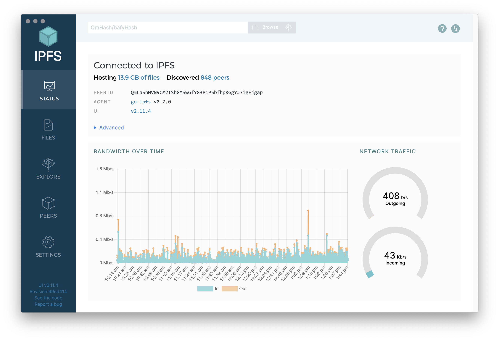

| Files screen                                                               | Explore screen                                                                 | Peers screen                                                               | Settings screen                                                                  | Menubar/taskbar                                                                      |
| -------------------------------------------------------------------------- | ------------------------------------------------------------------------------ | -------------------------------------------------------------------------- | -------------------------------------------------------------------------------- | ------------------------------------------------------------------------------------- |
| 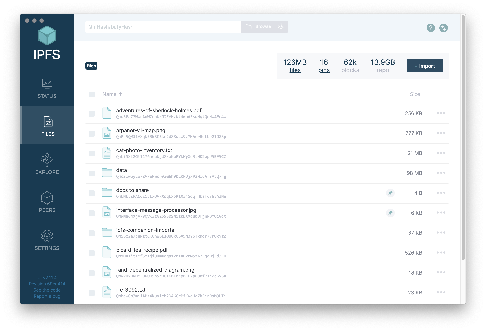 | 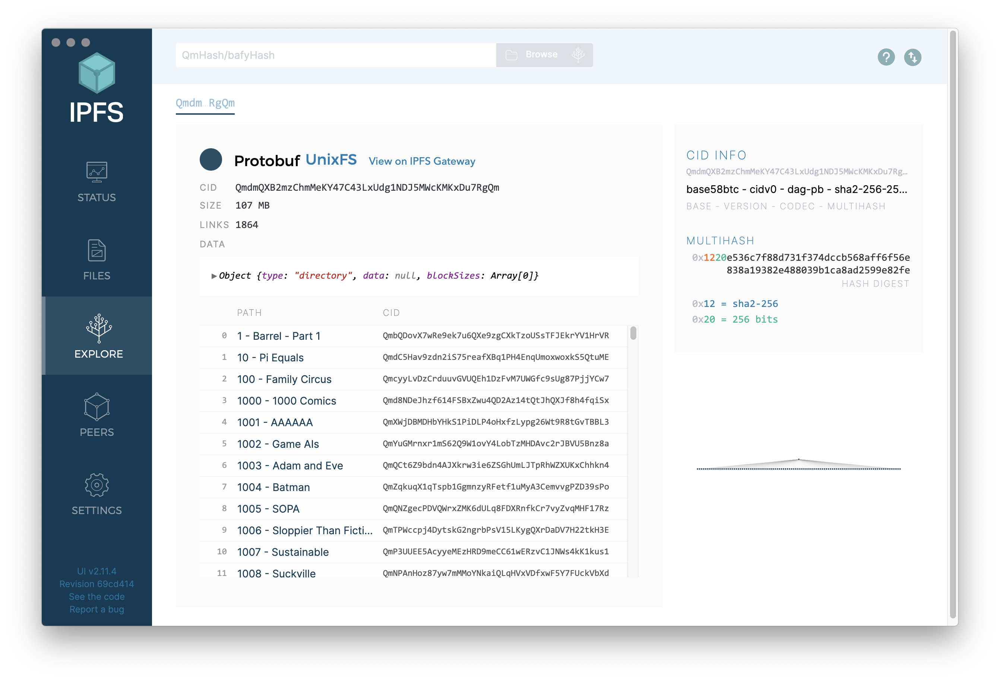 | 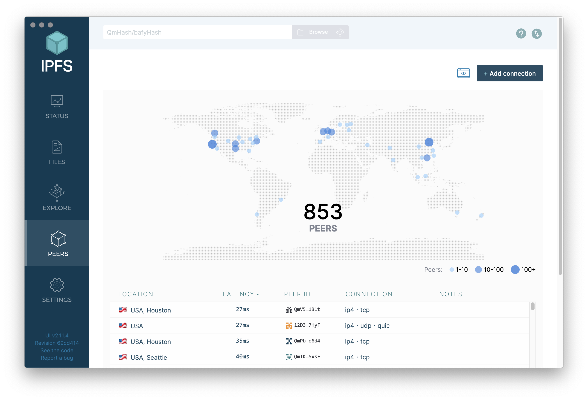 | 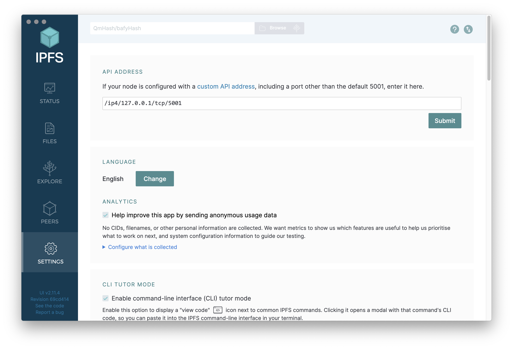 | 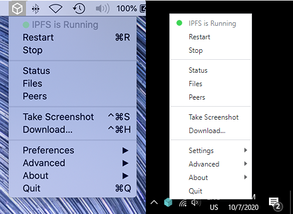 |

### Основни характеристики

- **Стартирайте своя възел при стартиране на системата (Mac/Windows) и управлявайте го от вашата OS** с удобно меню в лентата на задачите/системния tray.
- **Бързо импортирайте файлове, папки и екранни снимки в IPFS** по различни удобни начини, включително drag-and-drop и (за Windows) кликване с десния бутон върху иконата на файл/папка.
- **Лесно управлявайте съдържанието на вашия възел** с познат файлов браузър, предлагащ бързи преки пътища за преименуване/преместване/закачане на файлове и папки, визуализация на много често срещани файлови формати директно в IPFS Desktop, копиране на идентификатори на съдържание или споделяеми връзки в клипборда и др.
- **Бързо изтегляне за CIDs, IPFS пътища и IPNS пътища** — изберете `Download...` чрез десен клик върху иконата на IPFS в лентата на задачите, поставете хеш и сте готови.
- **Визуализирайте вашите IPFS peers по света** на карта, показваща към кои възли сте свързани, къде се намират, какви връзки използват и др.
- **Разглеждайте „Merkle Forest“ на IPFS файлове** с визуализатор, който ви позволява да видите първо как примерни набори от данни, съхранени в IPFS — или вашите собствени IPFS файлове — се разделят на части, адресирани по съдържание.
- **Поддръжка в цялата OS за IPFS файлове и връзки** (на Mac, Windows и някои Linux варианти) автоматично предава връзки, започващи с `ipfs://` и `ipns://`, за да бъдат отворени в IPFS Desktop.
- **CLI Tutor Mode** ви помага да научавате IPFS команди по време на работа.

### Инструкции за инсталиране

За да инсталирате IPFS Desktop, следвайте специфичните инструкции за вашата операционна система. IPFS Desktop е създаден с помощта на [Electron framework](https://www.electronjs.org), така че приложението трябва да работи навсякъде, където работи Electron.

| [Windows](#windows)                                                 | [macOS](#macos)                                               | [Ubuntu](#ubuntu)                                                |
| ------------------------------------------------------------------- | ------------------------------------------------------------- | ---------------------------------------------------------------- |
| [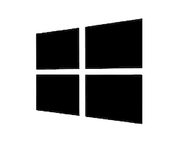](#windows) | [](#macos) | [](#ubuntu) |

Или, ако предпочитате да използвате мениджър на пакети, разгледайте този [списък с пакети на трети страни](#package-managers), поддържан от общността на IPFS.

## Windows

1. Отидете на [IPFS Desktop downloads page](https://github.com/ipfs/ipfs-desktop/releases)
2. Намерете връзката, която завършва с `.exe` за най-новата версия на IPFS Desktop:

   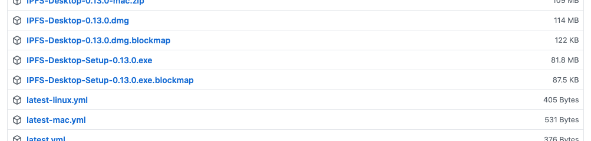
   (Ако списъкът е дълъг, може да бъде скрит под линка "Show all assets".)

3. Стартирайте `.exe` файла, за да започнете инсталирането.
4. Изберете дали искате да инсталирате приложението само за вас или за всички потребители на компютъра. Кликнете **Next**:

   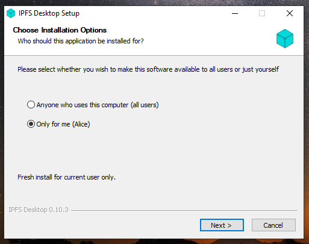

5. Изберете местоположението за инсталиране на приложението. По подразбиране обикновено е добре. Кликнете **Next**:

   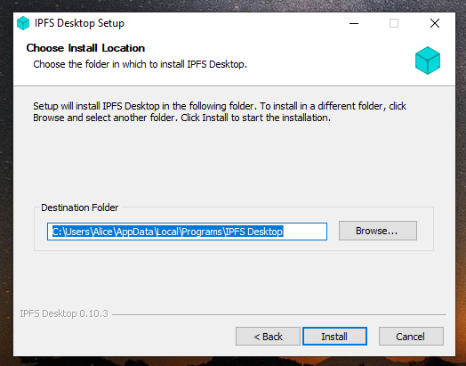

6. Изчакайте инсталацията да завърши и кликнете **Finish**:

   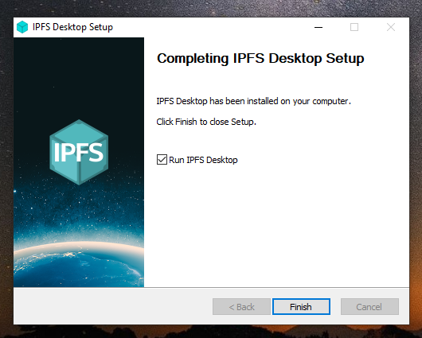

7. Сега можете да намерите IPFS икона в лентата на състоянието:

   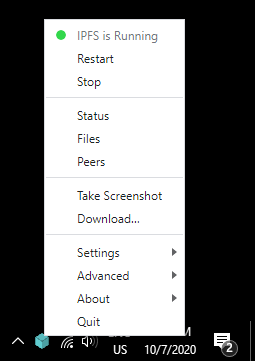

Приложението IPFS Desktop вече е инсталирано. Сега, [добавете вашия сайт](../how-to/websites-on-ipfs/single-page-website.md#add-your-site).

## macOS

1. Изтеглете най-новия `.dmg` файл от [ipfs/ipfs-desktop releases page](https://github.com/ipfs/ipfs-desktop/releases)

   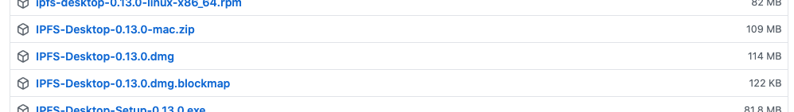

2. Отворете файла `ipfs-desktop.dmg`.
3. Плъзнете иконата на IPFS в папката **Applications**:

   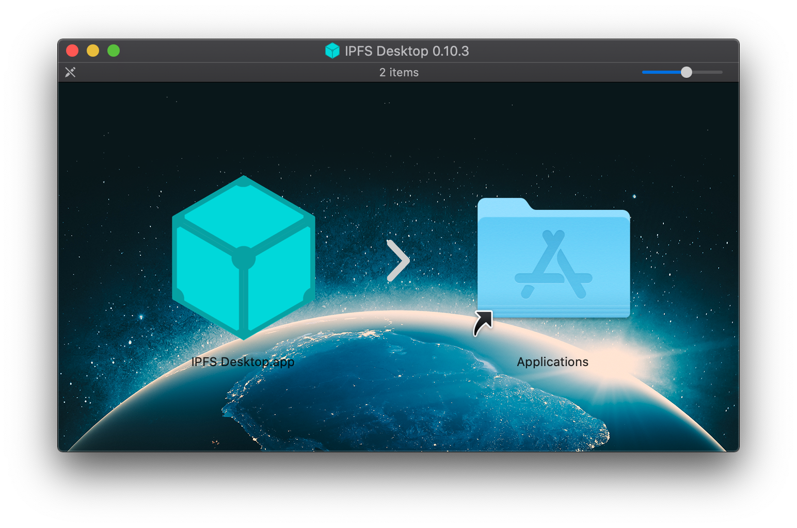

4. Отворете папката **Applications** и стартирайте приложението IPFS Desktop.
5. Може да получите предупреждение, че _IPFS Desktop.app can't be opened_. Кликнете **Show in Finder**:

   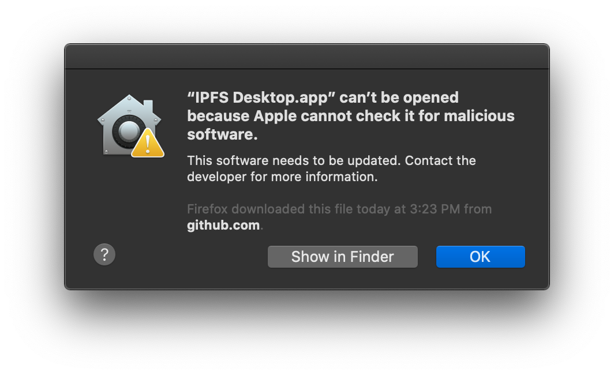

6. Намерете **IPFS Desktop.app** в папката **Applications**.
7. Задръжте клавиша `control`, кликнете върху **IPFS Desktop.app** и изберете **Open**:

   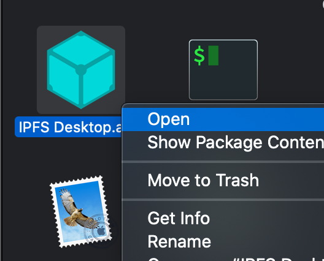

8. Кликнете **Open** в новия прозорец:

   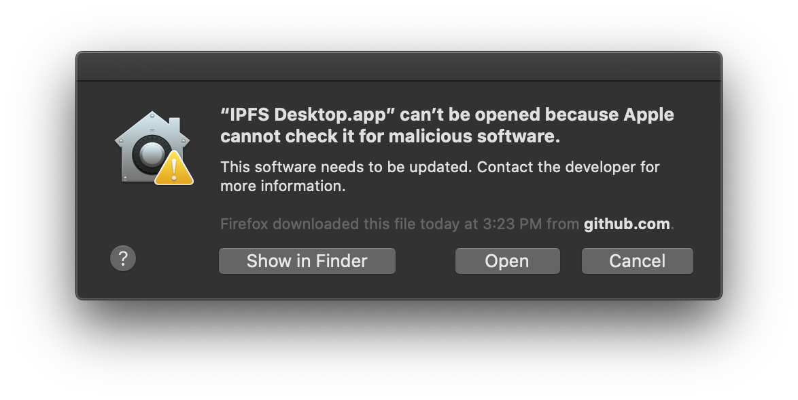

9. Сега можете да намерите IPFS икона в лентата на състоянието:

   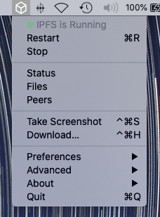

Приложението IPFS Desktop вече е инсталирано. Сега, [добавете вашия сайт](../how-to/websites-on-ipfs/single-page-website.md#add-your-site).

## Ubuntu

Въпреки че тези инструкции са специфични за Ubuntu, те вероятно ще работят и за повечето Ubuntu-подобни Linux дистрибуции. За не-Ubuntu Linux дистрибуции, проверете [IPFS Desktop GitHub repository](https://github.com/ipfs/ipfs-desktop#install) за инструкции за инсталиране.

### Инсталиране с `.deb`

1. Изтеглете най-новия `.deb` инсталатор от [IPFS Desktop GitHub repository](https://github.com/ipfs/ipfs-desktop#linuxfreebsd).
2. Кликнете двукратно, за да инсталирате пакета с Ubuntu Software, или отидете в папката, където сте изтеглили инсталатора и инсталирайте го от командния ред:

    ```shell
    sudo dpkg -i ./ipfs-desktop-[version]-amd64.deb
    ```

    Заменете `[version]` с номер на версията на IPFS пакета, който току-що сте изтеглили.

### Инсталиране с AppImage

:::warning
Когато инсталирате IPFS Desktop с изпълним AppImage файл, няма да имате достъп до командните `ipfs` команди. Това ограничение се дължи на начина, по който AppImages работят и как контейнеризират своите процеси.

Ако сте сигурни, че не ви трябват командните `ipfs` команди, можете да продължите с инсталирането на AppImage. В противен случай, помислете за използване на [deb инсталатора ↑](#install-with-deb)
:::

1. Изтеглете най-новия `.AppImage` пакет от [IPFS Desktop GitHub repository](https://github.com/ipfs/ipfs-desktop#linuxfreebsd).
2. Отидете в папката, където сте изтеглили `.AppImage` файла, и го направете изпълним:

   ```shell
   cd Downloads
   chmod a+x ./ipfs-desktop-linux.AppImage
   ```

3. Отворете `.AppImage`, като извикате `./ipfs-desktop-linux.AppImage` от командния ред:

   ```shell
   ./ipfs-desktop-linux.AppImage
   ```

   Можете също да стартирате `.AppImage` файла, като го отворите двойно кликване във файловия мениджър.

## Мениджъри на пакети

| Мениджър на пакети                                                                                               | Команда                      |
| ------------------------------------------------------------------------------------------------------------------ | ---------------------------- |
| [Homebrew](https://formulae.brew.sh/formula/ipfs#default)                                                                    | `brew install ipfs --cask`     |
| [Chocolatey](https://community.chocolatey.org/packages/ipfs-desktop)                                                         | `choco install ipfs-desktop` |
| [Scoop](https://github.com/ScoopInstaller/Extras/blob/master/bucket/ipfs-desktop.json) поддържан от [@NatoBoram](https://github.com/NatoBoram) | `scoop bucket add extras && scoop install ipfs-desktop` |
| [AUR](https://aur.archlinux.org/packages/ipfs-desktop/) поддържан от [@RubenKelevra](https://github.com/RubenKelevra) | `ipfs-desktop`               |

## Следващи стъпки

След като сте инсталирали IPFS Desktop, можете да започнете да споделяте файлове и да взаимодействате с други възли в мрежата! Разгледайте как да [хоствате уебсайт чрез IPFS →](../how-to/websites-on-ipfs/single-page-website.md)
