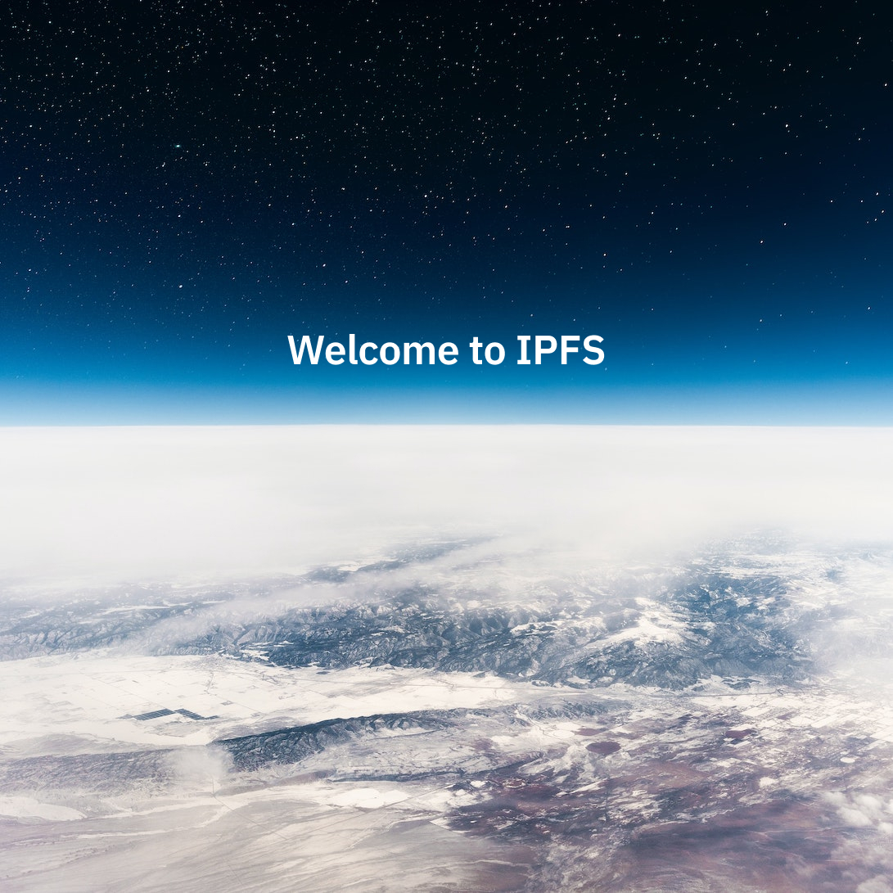

# Закачете файл с IPFS чрез командния ред

Подобно на [бързия старт Pin a file with IPFS](./pin.md), това ръководство ще ви научи за [услугите за pinning](../concepts/persistence.md#pinning-in-context) и как да ги използвате, за да публикувате данни, адресирани по съдържание, в IPFS. Въпреки това, вместо да използвате уеб интерфейс, ще качвате файлове с помощта на **командни инструменти и API**, предоставени от различни услуги за pinning. В края на това ръководство трябва да имате по-добро разбиране как работят адресирането по съдържание и CIDs на високо ниво, както и как да използвате CLI инструменти, за да публикувате данни в IPFS.

:::callout
Ако предпочитате графичен интерфейс, вижте [Закачане чрез браузърни интерфейси](./pin.md).
:::

## Съдържание <!-- omit from toc -->

- [Преглед](#overview)
- [Услуги за pinning](#pinning-services)
- [Предварителни изисквания](#prerequisites)
- [Качване и pin на файл](#upload-and-pin-a-file)
- [Обяснение на CIDs](#cids-explained)
- [Извличане чрез gateway](#retrieving-with-a-gateway)
- [Обобщение и следващи стъпки](#summary-and-next-steps)

## Преглед

_Пинването_ се отнася до процеса на гарантиране, че определено парче съдържание е достъпно за извличане с IPFS. С други думи, pinning е еквивалентно на съхраняване на файл на компютър или сървър, свързан с интернет, по този начин го правейки достъпен за останалата част от IPFS мрежата.

Pinning може да се прави на различни нива, от отделни файлове до цели директории, адресирани от CID. Можете също да pin-вате CIDs към множество IPFS възли, за да увеличите redundancy и устойчивостта на файла в мрежата.

## Услуги за pinning

[Услугите за pinning](../concepts/glossary.md#pinning-service) са подобни на hosting услугите, защото стартират IPFS възел за вас и гарантират, че вашите файлове са налични в IPFS мрежата.

:::callout
Данните, pin-нати в IPFS мрежата, са публични по подразбиране и могат да бъдат извличани от всеки. Избягвайте публикуването на частни данни или ги криптирайте адекватно преди публикуване.
:::

## Опция за self-hosting

Можете да стартирате собствен IPFS възел с помощта на [Kubo](../install/command-line.md), за да pin-вате файлове локално:

- **Пълен контрол**: Стартирайте `ipfs daemon`, за да стартирате възела си и използвайте `ipfs pin` команди за управление на pin-нато съдържание
- **Комбиниране с услуги за pinning**: Използвайте както локално pinning, така и remote услуги за [redundancy](../concepts/glossary.md#redundancy) — данните остават налични, дори ако възелът ви бъде офлайн
- **Научете повече**: Вижте [Kubo quickstart](../how-to/command-line-quick-start.md) и [pinning files guide](../how-to/pin-files.md) за подробни инструкции

Работата с собствен възел ви дава пълен контрол върху данните, докато участвате в IPFS мрежата.

## Предварителни изисквания

- Unix-подобен терминал или команден ред
- **Опция A**: Собствен IPFS възел
  - Инсталирайте [Kubo](../install/command-line.md) за достъп през командния ред
  - Стартирайте `ipfs init`, последвано от `ipfs daemon`, за да стартирате възела

- **Опция B**: Акаунт с поне една услуга за pinning (безплатен план е достатъчен):
  - [Pinata](https://pinata.cloud/) - Използва REST API с curl
  - [Filebase](https://filebase.com) - S3-съвместим, работи с AWS CLI

- Примерен файл за качване, например [следното изображение](../quickstart/images/welcome-to-IPFS.jpg):



## Качване и pin на файл

Изберете един от следните методи според вашата настройка:

### Използване на Kubo (self-hosted)

Ако стартирате собствен Kubo възел, използвайте командите `ipfs add` и `ipfs pin`. Вижте [pinning files guide](../how-to/pin-files.md) за подробни инструкции и [working with remote pinning services](../how-to/work-with-pinning-services.md), за да конфигурирате remote pinning.

### Опция 1: Pinata API

Pinata предоставя REST API, което можете да използвате с curl или всеки HTTP клиент. Вижте тяхната [API документация](https://docs.pinata.cloud/) за настройки на автентикация.

Основна употреба с curl:
```shell
# Задайте вашите API данни
export PINATA_API_KEY="your_api_key"
export PINATA_SECRET_API_KEY="your_secret_key"

# Качване на файл
curl -X POST https://api.pinata.cloud/pinning/pinFileToIPFS \
  -H "pinata_api_key: $PINATA_API_KEY" \
  -H "pinata_secret_api_key: $PINATA_SECRET_API_KEY" \
  -F "file=@welcome-to-IPFS.jpg"
```

### Опция 2: Filebase S3-съвместим API и Kubo RPC

Filebase предлага S3-съвместим API, което улеснява използването с AWS CLI или всеки S3 SDK. Вижте тяхната [S3-compatible API documentation](https://docs.filebase.com/api-documentation/s3-compatible-api) и [developer quick start guide](https://docs.filebase.com/getting-started/getting-started-guides/developer-quick-start-guide). Те също предлагат подмножество от Kubo RPC API — вижте [IPFS RPC API documentation](https://docs.filebase.com/api-documentation/ipfs-rpc-api).

Основна употреба с AWS CLI:
```shell
# Конфигурирайте AWS CLI с Filebase данни
aws configure --profile filebase

# Качване на файл в вашия IPFS bucket
aws --profile filebase s3 cp welcome-to-IPFS.jpg s3://your-bucket-name/
```

Всеки метод ще върне **CID** (Content Identifier) за качения файл. Запазете този CID, защото ще го използвате за извличане на файла.

## Обяснение на CIDs

В IPFS всеки файл и директория са идентифицирани чрез Content Identifier ([CID](../concepts/content-addressing.md)), уникален hash, изведен от съдържанието на файла. CID служи като **постоянен адрес** на файла и може да бъде използван от всеки, за да го намери в която и да е IPFS мрежа или система.

Когато добавите файл към IPFS, системата генерира неговия CID чрез хеширане на съдържанието. По-големите файлове (над ~1MB) се разделят на по-малки части, свързват се заедно и се хешират.

Полученият CID може да изглежда така:

```plaintext
bafybeicn7i3soqdgr7dwnrwytgq4zxy7a5jpkizrvhm5mv6bgjd32wm3q4
```

След като имате CID, можете да го споделите с всеки и те могат да извлекат файла чрез IPFS.

За да изследвате анатомията на CID, вижте [CID Inspector](https://cid.ipfs.tech/#bafybeicn7i3soqdgr7dwnrwytgq4zxy7a5jpkizrvhm5mv6bgjd32wm3q4). За да изследвате анатомията на DAG зад CID, вижте [DAG Explorer](https://explore.ipld.io/#/explore/bafybeicn7i3soqdgr7dwnrwytgq4zxy7a5jpkizrvhm5mv6bgjd32wm3q4).

:::callout
**Важно предупреждение:** Два идентични файла могат да генерират различни CIDs. CID отразява съдържанието *и* начина, по който файлът е обработен: размер на chunk-овете, DAG layout, hash алгоритъм, CID версия и други параметри на [UnixFS](https://specs.ipfs.tech/unixfs/). Един и същ файл, обработен с различни параметри, ще генерира различни CIDs. Вижте [CIDs are not file hashes](../concepts/content-addressing.md#cids-are-not-file-hashes) за подробности.
:::

## Извличане чрез gateway

Сега, след като файлът е pin-нат в услуга за pinning, можете да го извлечете с IPFS gateway. [**IPFS Gateway**](../concepts/ipfs-gateway.md) е HTTP интерфейс, който служи като мост към IPFS мрежата.

Можете да извлечете съдържанието чрез curl или уеб браузър:

### Използване на gateway, специфичен за услугата

**Pinata Gateway:**
```shell
curl https://gateway.pinata.cloud/ipfs/[CID]
```

**Filebase Gateway:**
```shell
curl https://ipfs.filebase.io/ipfs/[CID]
```

### Използване на публични gateways

Можете също да използвате [public IPFS gateways](../concepts/public-utilities.md#public-ipfs-gateways):

```shell
curl https://ipfs.io/ipfs/[CID]
# or
curl https://dweb.link/ipfs/[CID]
```

:::callout
Когато pin-вате файл в IPFS, името на файла не се съхранява по подразбиране. За да гарантирате, че името се запазва, обичайно е да увиете файла в директория. При такива случаи и файлът, и директорията имат уникални CIDs.
:::

## Обобщение и следващи стъпки

В този бърз старт научихте за [услугите за pinning](../concepts/persistence.md#pinning-in-context) и как да ги използвате, за да публикувате данни, адресирани по съдържание, в IPFS с помощта на командни инструменти. Проучихте различни CLI опции за Pinata и Filebase.

Услугите за pinning предоставят удобна алтернатива на стартирането на IPFS възли и инфраструктура. Въпреки това, те не са взаимно изключващи се; можете да комбинирате услуга за pinning с IPFS възел на вашия компютър, за да увеличите устойчивостта на вашите CIDs.

Възможни следващи стъпки включват:

- Разгледайте [жизнения цикъл на данните в IPFS](../concepts/lifecycle.md), за да научите повече за това как публикуването чрез pinning се вписва в целия жизнен цикъл на данните в IPFS
- Опитайте да извлечете pin-натия файл, следвайки [retrieval quickstart](./retrieve.md)
- Разгледайте web-based upload experience в [browser-based pin guide](./pin.md)
- Научете повече за API и SDK на всяка услуга:
  - [Pinata API documentation](https://docs.pinata.cloud/)
  - [Filebase S3 API guide](https://docs.filebase.com/api-documentation/s3-compatible-api)
  - [Filebase IPFS RPC API](https://docs.filebase.com/api-documentation/ipfs-rpc-api)
