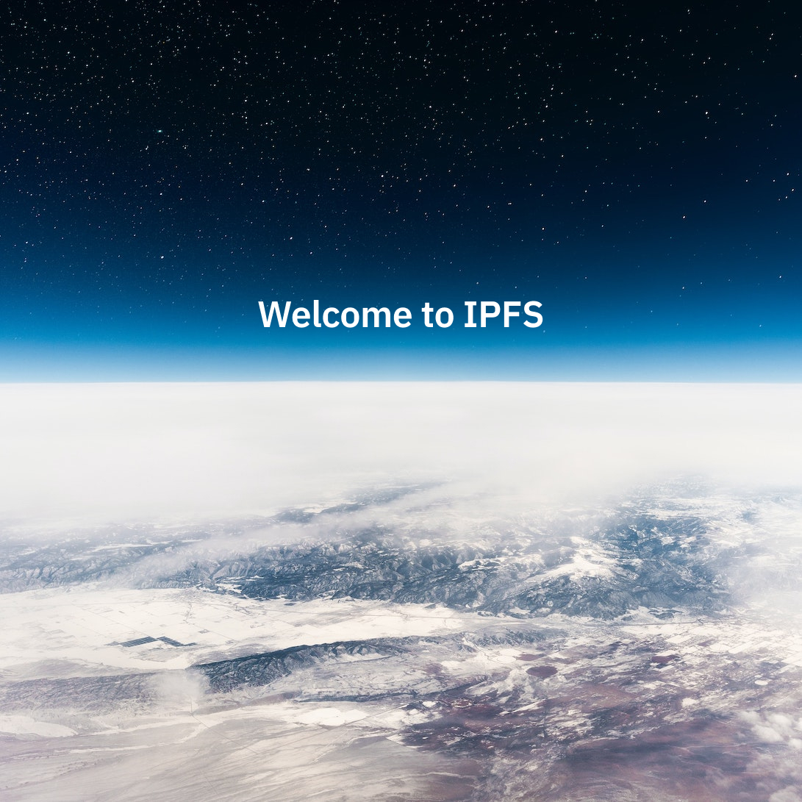

# Закачете файл в IPFS

В това ръководство за бърз старт ще научите за [услугите за pinning](../concepts/persistence.md#pinning-in-context) и как да използвате техните **уеб интерфейси**, за да публикувате съдържание в IPFS. В края на това ръководство трябва да имате по-добро разбиране за това как работят адресирането по съдържание и CID-ите на високо ниво.

:::callout
Ако предпочитате инструменти за команден ред, вижте [Закачване чрез команден ред](./pin-cli.md).
:::

## Съдържание <!-- omit from toc -->

- [Преглед](#преглед)
- [Услуги за pinning](#услуги-за-pinning)
- [Предпоставки](#предпоставки)
- [Качване и закрепване на файл](#качване-и-закрепване-на-файл)
- [Какво представляват CID-ите](#какво-представляват-cid-ите)
- [Извличане чрез gateway](#извличане-чрез-gateway)
- [Обобщение и следващи стъпки](#обобщение-и-следващи-стъпки)

## Преглед

_Pinning_ (закрепване) се отнася до процеса на осигуряване, че конкретен фрагмент от съдържание може да бъде извлечен в IPFS. С други думи, pinning е еквивалентно на съхраняване на файл на компютър или сървър, свързан с интернет, което го прави достъпен за останалата част от мрежата IPFS.

Закрепването може да се извършва на различни нива – от отделни файлове до цели директории, адресирани с CID. Можете също така да закрепите CIDs на множество възли IPFS, за да увеличите избыточността и устойчивостта на файла в мрежата.

## Услуги за pinning

[Услугите за pinning](../concepts/glossary.md#pinning-service) са подобни на хостинг услугите, тъй като управляват IPFS възел за вас и гарантират, че вашите файлове са налични в мрежата IPFS.

:::callout
Данните, закрепени в мрежата IPFS, са публични по подразбиране и могат да бъдат извличани от всеки. Избягвайте публикуването на частни данни или ги криптирайте адекватно, преди да ги публикувате.
:::

## Опция за самостоятелно хостване

Можете също така да стартирате свой собствен IPFS възел, за да закрепвате файлове локално! [IPFS Desktop](../install/ipfs-desktop.md) предоставя лесен за използване графичен интерфейс за управление на собствен IPFS възел:

- **Закрепвайте файлове локално**: Използвайте екрана Files в IPFS Desktop, за да импортирате и закрепите файлове. Щракнете с десния бутон върху всеки файл, за да получите опцията Pin в контекстното меню.
- **Комбинирайте с услуги за pinning**: За по-добра [избыточност](../concepts/glossary.md#redundancy) можете да закрепвате файлове както на локалния си възел, така и на отдалечени услуги за pinning.
- **Научете повече**: Следвайте [ръководството за IPFS Desktop](../how-to/desktop-app.md), за да започнете с [самостоятелно хостване](../concepts/glossary.md#self-hosting).

Стартирането на собствен възел ви дава пълен контрол върху данните ви, като същевременно участвате в глобалната мрежа IPFS.

## Предпоставки

За да следвате това ръководство, ще ви трябват:

- **Опция A**: Ваш собствен IPFS възел
  - Инсталирайте [IPFS Desktop](../install/ipfs-desktop.md) за графичен интерфейс.

- **Опция B**: Акаунт поне с една услуга за pinning (безплатният план е достатъчен):
  - [Pinata](https://pinata.cloud/) - Популярна услуга за IPFS pinning с прост уеб интерфейс
  - [Filebase](https://filebase.com) - Услуга за pinning, съвместима със S3, с уеб табло

- Примерен файл за качване, например [следното изображение](../quickstart/images/welcome-to-IPFS.jpg):



## Качване и закрепване на файл

Изберете една от следните опции, за да качите и закрепите първия си файл:

### Използване на IPFS Desktop (самостоятелно хостване)

Ако използвате IPFS Desktop, следвайте [ръководството за добавяне на локални файлове](../how-to/desktop-app.md#add-local-files), за да импортирате файла си. След импортиране щракнете с десния бутон върху файла и изберете **Pin**, за да гарантирате, че остава на вашия възел. За да получите CID, вижте [споделяне на файлове](../how-to/desktop-app.md#share-files).

Можете също да конфигурирате отдалечени услуги за pinning в IPFS Desktop. Вижте [работа с отдалечени услуги за pinning](../how-to/work-with-pinning-services.md) за подробности.

### Използване на услуга за pinning

Изберете една от следните услуги за pinning и използвайте нейния уеб интерфейс:

- **Pinata**: Използвайте [Pinata App](https://app.pinata.cloud) за лесно качване чрез drag-and-drop – вижте техния [ръководство за бърз старт](https://docs.pinata.cloud/quickstart)
- **Filebase**: Достъп до тяхното уеб табло и следвайте техния [ръководство за закрепване на първия файл](https://docs.filebase.com/getting-started/getting-started-guides/pin-your-first-file-to-ipfs)

Всяка от опциите ще ви предостави **CID** (Content Identifier) след качване на файла. Запазете този CID, защото ще го използвате, за да извлечете файла си в следващите раздели.

## Какво представляват CID-ите

В IPFS всеки файл и директория се идентифицира с идентификатор на съдържанието ([CID](../concepts/content-addressing.md)). CID служи като **постоянен адрес** на файла и може да бъде използван от всеки, за да го открие в мрежата IPFS.

Когато файлът бъде добавен за първи път към IPFS възел (като изображението, използвано в това ръководство), той първо се преобразува в представяне, адресирано по съдържание, при което файлът се разделя на по-малки блокове (ако е над ~1 MB), които са свързани помежду си и хеширани, за да се получи CID.

Например CID може да изглежда така:

```plaintext
bafybeicn7i3soqdgr7dwnrwytgq4zxy7a5jpkizrvhm5mv6bgjd32wm3q4
```

Сега можете да споделите CID с всеки и той може да изтегли файла с помощта на IPFS.

За да навлезете по-дълбоко в структурата на CID, разгледайте [CID inspector](https://cid.ipfs.tech/#bafybeicn7i3soqdgr7dwnrwytgq4zxy7a5jpkizrvhm5mv6bgjd32wm3q4).

:::callout
Преобразуването в представяне, адресирано по съдържание, е локална операция, която не изисква никаква мрежова свързаност. При много услуги за pinning това преобразуване се случва от клиента (в браузъра).
:::

## Извличане чрез gateway

Сега, след като файлът е закрепен в услуга за pinning, можете да го извлечете чрез IPFS gateway. [**IPFS Gateway**](../concepts/ipfs-gateway.md) е HTTP интерфейс, който служи като мост към мрежата IPFS. С други думи, той ви позволява да извличате CID-ове от IPFS чрез HTTP в уеб браузъра.

Услугите за pinning обикновено предлагат свои собствени IPFS gateway-ове:

### Gateway на Pinata
Pinata предлага както публични, така и специални опции за gateway. Специалните им gateway-ове осигуряват по-добра производителност и надеждност за продуктивна употреба. Достъп до съдържанието чрез:
- `https://gateway.pinata.cloud/ipfs/[CID]`

Научете повече за разликите между публичните и специалните gateway-ове в [ръководството за gateway на Pinata](https://knowledge.pinata.cloud/en/articles/6297294-public-gateways-vs-dedicated-gateways).

### Gateway на Filebase
Filebase предоставя достъп до gateway в следния формат:
- `https://[BUCKET_NAME].ipfs.filebase.io/ipfs/[CID]`

Имайте предвид, че gateway-ът на Filebase може да откаже хостване на HTML и работи предимно с ресурси като изображения или видеоклипове. За подробности вижте [документацията за IPFS gateway на Filebase](https://docs.filebase.com/ipfs-concepts/what-is-an-ipfs-gateway).

### Публични gateway-ове
Можете също да използвате публични IPFS gateway-ове, за да извличате всеки CID:
- `https://ipfs.io/ipfs/[CID]`
- `https://dweb.link/ipfs/[CID]`

Просто заменете `[CID]` с реалния си CID в адресната лента на браузъра, за да извлечете файла.

:::callout
Когато закрепяте файл в IPFS, името на файла не се съхранява по подразбиране. За да се запази името, често се използва обвиване на файла в директория. В такива случаи и файлът, и директорията имат уникални CID-ове. Много услуги за pinning обвиват файловете в директория по подразбиране.
:::

## Обобщение и следващи стъпки

В това ръководство за бърз старт научихте за [услугите за pinning](../concepts/persistence.md#pinning-in-context) и как да ги използвате, за да публикувате данни, адресирани по съдържание, в IPFS чрез уеб интерфейси. Разгледахте различни опции за услуги за pinning и научихте как да извличате съдържанието си чрез IPFS gateway-ове.

Услугите за pinning представляват удобна алтернатива на стартирането на IPFS възли и инфраструктура. Въпреки това, двете не са взаимно изключващи се; можете да комбинирате услуга за pinning с IPFS възел на вашия компютър, за да увеличите устойчивостта на вашите CID-ове.

Възможни следващи стъпки са:

- Разгледайте [жизнения цикъл на данните в IPFS](../concepts/lifecycle.md), за да научите повече за това как публикуването чрез pinning се вписва в пълния жизнен цикъл на данните в IPFS.
- Опитайте да извлечете закрепения файл, като следвате [ръководството за извличане](./retrieve.md).
- Научете как да [закрепвате файлове чрез команден ред](./pin-cli.md).
- Разгледайте документацията за конкретни услуги:
  - [Документация на Pinata](https://docs.pinata.cloud/)
  - [Документация на Filebase](https://docs.filebase.com/)