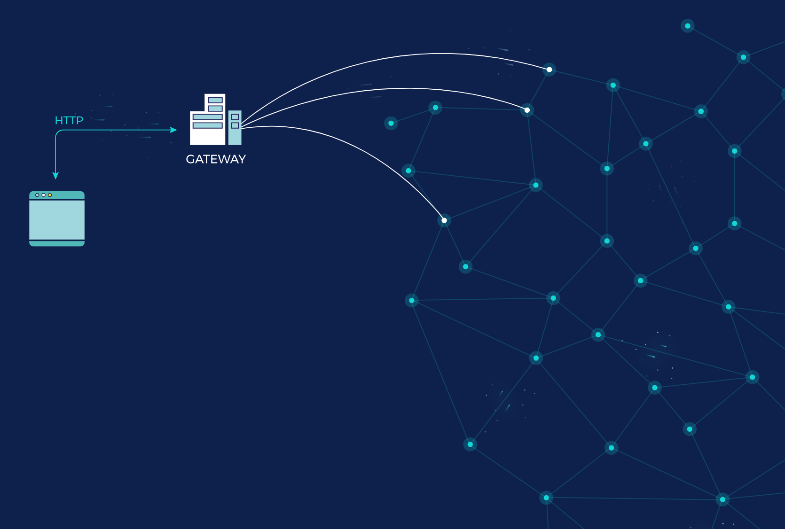

# Извличане на CID в IPFS

В това ръководство за бърз старт ще научите различните подходи за извличане на CID-ове от мрежата IPFS и как да изберете най-подходящия метод за вашите конкретни нужди.

Ще извлечете изображението със следния CID: `bafybeicn7i3soqdgr7dwnrwytgq4zxy7a5jpkizrvhm5mv6bgjd32wm3q4`.

:::callout
CID-ът, който ще извлечете, всъщност е директория, съдържаща един единствен изображен файл. Причината е, че когато файловете се добавят в IPFS, името на файла не се съхранява по подразбиране. За да се запази името, често се практикува обвиване на файла в директория. В такива случаи получавате два CID-а – един за файла и един за директорията, която го съдържа.
:::

## Съдържание <!-- omit from toc -->

- [Методи за извличане в IPFS](#методи-за-извличане-в-ipfs)
- [Проверено срещу доверено извличане на CID](#проверено-срещу-доверено-извличане-на-cid)
- [Извличане на CID с Kubo](#извличане-на-cid-с-kubo)
- [Проверено извличане с Helia Verified Fetch](#проверено-извличане-с-helia-verified-fetch)
- [Извличане на CID с Python и ipfsspec](#извличане-на-cid-с-python-и-ipfsspec)
- [Извличане на CID чрез IPFS Gateway](#извличане-на-cid-чрез-ipfs-gateway)
- [Обобщение и следващи стъпки](#обобщение-и-следващи-стъпки)

## Методи за извличане в IPFS

Има два основни начина за извличане на файлове и директории, публикувани в IPFS:

- Използвайте [**IPFS възел**](../concepts/nodes.md), като инсталирате една от имплементациите на IPFS, например [Kubo](../concepts/nodes.md#implementations), на вашия компютър. Това ви позволява да извличате и проверявате CID-ове от други възли в мрежата IPFS.
- Използвайте [**IPFS Gateway**](../concepts/ipfs-gateway.md) – HTTP интерфейс към мрежата IPFS, който ви позволява да извличате данни от IPFS чрез HTTP. Услугите за pinning обикновено предлагат IPFS gateway като начин за лесно извличане на вашите CID-ове.

Опцията **възел** ви дава достъп до пълния набор от IPFS протоколи. Опцията **Gateway** служи като мост в ситуации, в които може да сте ограничени до използване на HTTP, например в уеб приложения, където вашите потребители не работят с IPFS възел.

IPFS Gateway-овете в най-простата си форма обикновено са IPFS възли, хоствани от някой друг и представящи HTTP интерфейс за извличане на CID-ове, както е показано на диаграмата по-долу:



## Проверено срещу доверено извличане на CID

Друго нещо, което трябва да имате предвид при избора между двата подхода, е _проверката_. По подразбиране IPFS възел хешира всеки блок и гарантира, че когато файлът е конструиран от блоковете (в Merkle DAG), той дава CID-а, който сте поискали. Въпреки това, при IPFS Gateway-овете проверката е незадължителна.

Непровереното извличане често се нарича _доверено извличане_, защото се доверявате на gateway-а да върне правилния отговор, без да изчислява хеша.

Въпреки че проверката почти винаги се препоръчва, в реалния свят има ситуации, в които довереното извличане е прагматичен избор, например при вграждане на изображения в уебсайт.

## Извличане на CID с Kubo

За да извлечете CID с [Kubo](../install/command-line.md), следвайте стъпките по-долу:

1. Уверете се, че Kubo daemon е инсталиран и стартиран:

   ```bash
   $ ipfs daemon
   ```

2. За да извлечете файла, изпълнете командата [`ipfs get [CID]`](../reference/kubo/cli.md#ipfs-get):

   ```bash
   $ ipfs get bafybeicn7i3soqdgr7dwnrwytgq4zxy7a5jpkizrvhm5mv6bgjd32wm3q4
   ```

   Изходът трябва да изглежда така:

   ```bash
   Saving file(s) to bafybeicn7i3soqdgr7dwnrwytgq4zxy7a5jpkizrvhm5mv6bgjd32wm3q4
   647.61 KiB / 647.61 KiB [========================================================================================================================] 100.00% 0s
   ```

   Ще бъде създадена нова директория със същото име като CID-а:

   ```bash
   $ ls bafybeicn7i3soqdgr7dwnrwytgq4zxy7a5jpkizrvhm5mv6bgjd32wm3q4/
   welcome-to-IPFS.jpg
   ```

Честито, успешно извлечохте CID-а.

## Проверено извличане с Helia Verified Fetch

[Verified Fetch](https://www.npmjs.com/package/@helia/verified-fetch) опростява **провереното** извличане на CID-ове в уеб средата, като скрива детайлите за content routing, transport и retrieval. API-то е подобно на [Fetch API](https://developer.mozilla.org/en-US/docs/Web/API/Fetch_API), приема CID-ове вместо URL адреси и връща обекти [Response](https://developer.mozilla.org/en-US/docs/Web/API/Response).

Например, следният код извлича изображението с библиотеката `verifiedFetch`:

<iframe height="300" style="width: 100%;" scrolling="no" title="Fetch an image on IPFS Mainnet @helia/verified-fetch" src="https://codepen.io/2color/embed/dPyZyry?default-tab=js%2Cresult" frameborder="no" loading="lazy" allowtransparency="true" allowfullscreen="true">
  See the Pen <a href="https://codepen.io/2color/pen/dPyZyry">
  Fetch an image on IPFS Mainnet @helia/verified-fetch</a> by Daniel Norman (<a href="https://codepen.io/2color">@2color</a>)
  on <a href="https://codepen.io">CodePen</a>.
</iframe>

:::callout
Може да забележите, че след CID-а има път, например `bafybeicn7i3soqdgr7dwnrwytgq4zxy7a5jpkizrvhm5mv6bgjd32wm3q4/welcome-to-IPFS.jpg`, защото началният CID е директория, която съдържа файла `welcome-to-IPFS.jpg`, който можете да извлечете директно с: `verifiedFetch('ipfs://bafkreie7ohywtosou76tasm7j63yigtzxe7d5zqus4zu3j6oltvgtibeom')`.
:::

## Извличане на CID с Python и ipfsspec

[ipfsspec](https://github.com/fsspec/ipfsspec) е read-only [fsspec](https://filesystem-spec.readthedocs.io/) имплементация за IPFS. Тя извършва **проверено** HTTP извличане от gateway-ове, като взима [CAR файлове](../concepts/glossary.md#car), съдържащи Merkle доказателства, така че не е нужно да се доверявате на gateway-а. Работи без локален IPFS възел.

1. Инсталирайте `fsspec` и `ipfsspec`:

   ```bash
   pip install fsspec ipfsspec
   ```

2. Извлечете изображението с `fsspec.open`:

```python
import fsspec

cid = "ipfs://bafybeicn7i3soqdgr7dwnrwytgq4zxy7a5jpkizrvhm5mv6bgjd32wm3q4/welcome-to-IPFS.jpg"

with fsspec.open(cid, "rb") as f:
    image_data = f.read()
    print(f"Retrieved {len(image_data)} bytes")
```

Можете също така да адресирате файла директно по собствения му CID:

```python
with fsspec.open("ipfs://bafkreie7ohywtosou76tasm7j63yigtzxe7d5zqus4zu3j6oltvgtibeom", "rb") as f:
    image_data = f.read()
```

За да определите кой gateway да използвате, ipfsspec следва [IPIP-280](https://github.com/ipfs/specs/pull/280). Можете да го насочите към друг gateway чрез опциите, като зададете променливата на средата `IPFS_GATEWAY` или запишете URL адреса на gateway-а в `~/.ipfs/gateway`.

## Извличане на CID чрез IPFS Gateway

За да извлечете CID чрез IPFS gateway е толкова просто, колкото да заредите един от следните URL адреси:

- [https://ipfs.io/ipfs/bafybeicn7i3soqdgr7dwnrwytgq4zxy7a5jpkizrvhm5mv6bgjd32wm3q4](https://ipfs.io/ipfs/bafybeicn7i3soqdgr7dwnrwytgq4zxy7a5jpkizrvhm5mv6bgjd32wm3q4)
- [https://dweb.link/ipfs/bafybeicn7i3soqdgr7dwnrwytgq4zxy7a5jpkizrvhm5mv6bgjd32wm3q4](https://dweb.link/ipfs/bafybeicn7i3soqdgr7dwnrwytgq4zxy7a5jpkizrvhm5mv6bgjd32wm3q4)
- [https://inbrowser.link/ipfs/bafybeicn7i3soqdgr7dwnrwytgq4zxy7a5jpkizrvhm5mv6bgjd32wm3q4](https://inbrowser.link/ipfs/bafybeicn7i3soqdgr7dwnrwytgq4zxy7a5jpkizrvhm5mv6bgjd32wm3q4)

> `inbrowser.link` се захранва от [Service Worker Gateway](https://github.com/ipfs/service-worker-gateway), който обработва извличането и проверката в браузъра, като използва и кеширане в браузъра, което прави следващите зареждания по-бързи и работещи локално, дори когато сте офлайн.

## Обобщение и следващи стъпки

В това ръководство за бърз старт научихте различните подходи за извличане на CID-ове от мрежата IPFS и как да изберете най-подходящия метод за вашите конкретни нужди.

След това извлечохте изображението, което беше закрепено в [ръководството за публикуване чрез услуга за pinning](./pin.md), с помощта на IPFS Kubo възел и IPFS Gateway.

Възможни следващи стъпки са:

- Научете повече за [как работи IPFS](../concepts/how-ipfs-works.md) и [жизнения цикъл на данните в IPFS](../concepts/lifecycle.md).

